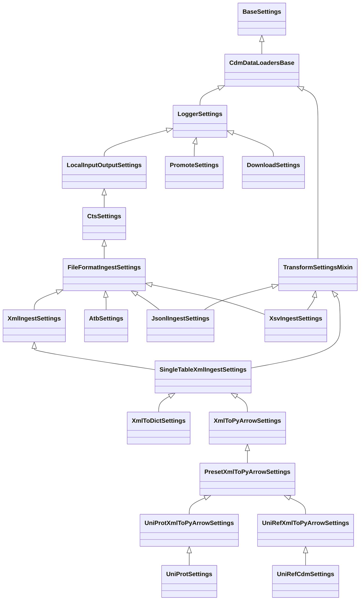
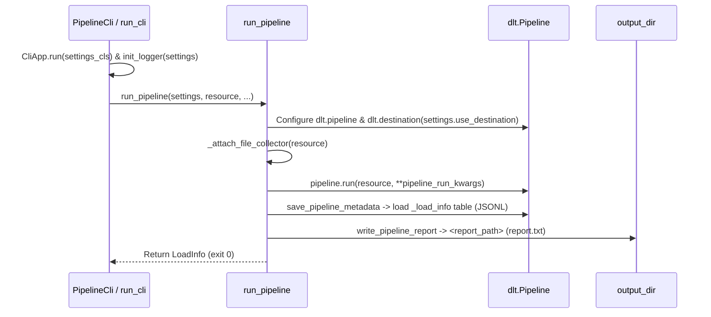

# Core Pipeline & KBase CTS Execution Guide

This guide explains how `cdm-data-loaders` pipelines are configured, executed locally and inside containers on the KBase Container Task Service (CTS), and how they report results, logs, and rejected records.

---

## 1. Execution Modes

Every pipeline in `src/cdm_data_loaders/pipelines/` exposes a `PipelineCli` instance (`cli = PipelineCli(...)`) registered under `[project.scripts]` in `pyproject.toml`. Pipelines can be executed in three ways:

### Local CLI Execution (`uv run`)

Run any registered pipeline entry point directly via `uv`:

```bash
uv run xsv \
  --input-dir /path/to/input_dir \
  --output-dir /path/to/output_dir \
  --use-destination local_fs \
  --dataset-name my_dataset \
  --table-name sample_rows \
  --file-glob "*.tsv*" \
  --schema-file /path/to/schema.json
```

### Container Execution (`scripts/entrypoint.sh`)

Inside the Docker container (or when running `./scripts/entrypoint.sh`), the first positional argument selects the execution mode:

| Mode            | Invocation                                                         | Description                                                                                                         |
| :-------------- | :----------------------------------------------------------------- | :------------------------------------------------------------------------------------------------------------------ |
| `pipeline`      | `./scripts/entrypoint.sh pipeline <pipeline_cli> [args...]`        | Copies `/input_dir/dlt_conf/*` into `$HOME/.dlt` (if present) and runs the registered `<pipeline_cli>` entry point. |
| `CheckM2`       | `./scripts/entrypoint.sh CheckM2 <genome_paths_file> <output_dir>` | Runs CheckM2 via `scripts/run_tools.sh` and parses the quality report (`parsers/checkm2.py`).                       |
| `BBTools`       | `./scripts/entrypoint.sh BBTools <genome_paths_file> <output_dir>` | Runs BBMap `stats.sh` via `scripts/run_tools.sh` and parses assembly statistics (`parsers/bbmap_stats.py`).         |
| `ncbi-manifest` | `./scripts/entrypoint.sh ncbi-manifest [args...]`                  | Runs Phase 1 NCBI FTP assembly summary diffing and manifest generation (`cdm_data_loaders.ncbi_ftp.manifest`).      |

Example container invocation:

```bash
docker run --rm \
  -v /local/input:/input_dir \
  -v /local/output:/output_dir \
  ghcr.io/kbase/cdm-data-loaders:latest \
  pipeline jsonlines_extract \
  --input-dir /input_dir \
  --output-dir /output_dir \
  --use-destination local_fs \
  --dataset-name my_dataset \
  --table-name events \
  --file-glob "*.jsonl.gz"
```

### Programmatic Execution (`PipelineCli.run` / `run_pipeline`)

In Python (or in `ExecutionMode.CORE` within `PipelineTestRunner`), invoke the pipeline's `PipelineCli.run()` or call `run_pipeline()` from `cdm_data_loaders.pipelines.core`:

```python
from cdm_data_loaders.pipelines.jsonlines.extract_pipeline import (
    JsonlExtractSettings,
    run_jsonlines_pipeline,
)

settings = JsonlExtractSettings(
    input_dir="/path/to/input_dir",
    output_dir="/path/to/output_dir",
    use_destination="local_fs",
    dataset_name="my_dataset",
    table_name="events",
    file_glob="*.jsonl*",
)
load_info = run_jsonlines_pipeline(settings)
```

---

## 2. The KBase CTS Exit-Code-0 Contract

Pipelines in production run on the **KBase Container Task Service (CTS)**. CTS enforces an important storage lifecycle rule:

> **CTS only uploads the contents of `/output_dir` (and pipeline artifacts written there) if the container exits with exit code `0`.** If a container exits with a non-zero exit code, CTS captures `STDOUT` and `STDERR` logs, **but discards everything written to `/output_dir`**.

To preserve diagnostic artifacts, `PipelineCli` / `run_cli()` and `run_pipeline()` in `src/cdm_data_loaders/pipelines/core.py` separate failures into two phases:

1. **Pre-execution configuration, CLI & destination validation errors (Non-zero exit)**:
   - Errors raised by `pydantic_settings.CliApp.run(settings_cls)` (missing required flags, invalid file paths, unknown options, or invalid `TABLE_TRANSFORMS` modules) or invalid `use_destination` configuration occur *before* pipeline extraction starts.
   - Because no output data has been produced yet, these errors raise immediately and terminate the process with a non-zero exit code so CTS flags the task failure and records the traceback from `STDERR`.
2. **Runtime pipeline & `dlt` load errors (Exit code `0`)**:
   - Once `pipeline.run()` begins inside `run_pipeline()`, runtime step failures (`PipelineStepFailed`) and failed jobs (`load_info.has_failed_jobs`) are caught and logged.
   - `save_pipeline_metadata()` writes the `LoadInfo` record to the `_load_info` table and writes `PipelineReport` YAML to `settings.report_path` (`report.txt`) with `status: error` or `status: completed with errors`, `pipeline_err_msg`, and `load_errors`.
   - `PipelineCli.__call__()` returns `None` so the container **exits with code `0`**, preserving `report.txt`, logs, `_load_info`, and `_rejected` tables in `/output_dir` for CTS to upload.

---

## 3. Settings Class Hierarchy & CLI Configuration

All pipeline settings inherit from the `pydantic-settings` hierarchy defined in `src/cdm_data_loaders/core/settings.py`:



### Shared Rules Across All Settings Classes

- **Environment Variable Prefix (`CDL_`)**: Every setting can be populated via an environment variable prefixed with `CDL_`, e.g., `CDL_DATASET_NAME=my_dataset` or `CDL_INPUT_DIR=/data/in`.
- **Kebab-Case CLI Flags**: Field names use `snake_case` in Python and `--kebab-case` on the CLI (e.g., `dataset_name` -> `--dataset-name`).
- **Explicit CLI Parsing**: `cli_parse_args` is not enabled on model instantiation (`default_settings_with_shortcuts()`), so constructing settings objects in Python code or unit tests never reads `sys.argv`. CLI parsing only happens when `PipelineCli` invokes `pydantic_settings.CliApp.run(settings_cls)`.
- **Compile-Time Alias & Shortcut Validation**: `CdmDataLoadersBase.__pydantic_init_subclass__` calls `check_aliases()` whenever a settings subclass is defined, ensuring no field name, `validation_alias`, or `cli_shortcuts` entry collides or claims `-h` / `--help`.

### Settings Layers and Fields

#### `LoggerSettings`

Configures structured JSON logging (`src/cdm_data_loaders/utils/cdm_logger.py`):

| Field             | CLI Flag            | Shortcut | Default | Description                                                                                   |
| :---------------- | :------------------ | :------- | :------ | :-------------------------------------------------------------------------------------------- |
| `log_config_file` | `--log-config-file` | —        | `None`  | Optional path to a custom JSON logging configuration file (defaults to `logger_config.json`). |

#### `LocalInputOutputSettings`

Adds validated input and output directory settings (`src/cdm_data_loaders/core/path_fields.py`):

| Field        | CLI Flag       | Shortcut | Default      | Description                                                                                                |
| :----------- | :------------- | :------- | :----------- | :--------------------------------------------------------------------------------------------------------- |
| `input_dir`  | `--input-dir`  | `-i`     | *(Required)* | Local directory (plain path or `file://` URL, must exist) or `fsspec` URL containing file(s) to import.   |
| `output_dir` | `--output-dir` | `-o`     | *(Required)* | Local directory for output artifacts, `report.txt`, and optional pipeline metadata (`pipeline_metadata`). |

#### `CtsSettings`

Base settings for `dlt`-backed CTS pipelines (`CLI_SHORTCUTS`):

| Field                                  | CLI Flag                                 | Shortcut | Default      | Description                                                                                       |
| :------------------------------------- | :--------------------------------------- | :------- | :----------- | :------------------------------------------------------------------------------------------------ |
| `use_destination`                      | `--use-destination`                      | `-d`     | *(Required)* | Named `dlt` destination configured in `.dlt/config.toml` (`destination.<name>.destination_type`). |
| `buffer_size`                          | `--buffer-size`                          | —        | `100`        | Number of rows buffered per table before yielding a batch to the destination.                     |
| `dlt_dev_mode`                         | `--dlt-dev-mode`                         | —        | `False`      | Enable `dlt` `dev_mode` (resets state and appends a timestamp to `dataset_name`).                 |
| `log_interval`                         | `--log-interval`                         | —        | `1000`       | Emit a progress log message every $N$ processed entries.                                          |
| `use_output_dir_for_pipeline_metadata` | `--use-output-dir-for-pipeline-metadata` | `-p`     | `False`      | Store `dlt` pipeline metadata in `<output_dir>/pipeline_metadata` instead of `~/.dlt/pipelines`.  |

`CtsSettings` also exposes two computed properties:
- `pipeline_dir`: `<output_dir>/pipeline_metadata` when `use_output_dir_for_pipeline_metadata` is `True`, else `None`.
- `report_path`: `<pipeline_dir>/report.txt` when `pipeline_dir` is set, else `<output_dir>/report.txt`.

#### `FileFormatIngestSettings`

Extends `CtsSettings` for file-format ingestion pipelines (`FILE_FORMAT_CLI_SHORTCUTS`):

| Field                | CLI Flag               | Shortcut | Default      | Description                                                                |
| :------------------- | :--------------------- | :------- | :----------- | :------------------------------------------------------------------------- |
| `dataset_name`       | `--dataset-name`       | —        | *(Required)* | Name of the dataset / schema produced in the `dlt` destination.            |
| `loader_file_format` | `--loader-file-format` | `-f`     | `"parquet"`  | Output file or table format for `dlt` (`iceberg`, `jsonl`, or `parquet`). |

#### `XmlIngestSettings` & `SingleTableXmlIngestSettings`

Extends `FileFormatIngestSettings` (and `TransformSettingsMixin`) for XML pipelines (`XML_CLI_SHORTCUTS`):

| Field        | CLI Flag       | Shortcut | Default      | Description                                                                               |
| :----------- | :------------- | :------- | :----------- | :---------------------------------------------------------------------------------------- |
| `file_glob`  | `--file-glob`  | `-g`     | `"*.xml*"`   | Glob pattern matching XML files (including `.xml.gz`) under `input_dir`.                  |
| `table_name` | `--table-name` | `-t`     | *(Required)* | Target table name (`SingleTableXmlIngestSettings`; preset on `uniprot`/`uniref*`).        |
| `xml_tag`    | `--xml-tag`    | `-x`     | *(Required)* | Repeating record XML tag (`SingleTableXmlIngestSettings`; preset on `uniprot`/`uniref*`). |

#### `TransformSettingsMixin`

Mixed into `JsonlIngestSettings`, `XsvIngestSettings`, and `SingleTableXmlIngestSettings`:

| Field                   | CLI Flag                  | Shortcut | Default | Description                                                                                             |
| :---------------------- | :------------------------ | :------- | :------ | :------------------------------------------------------------------------------------------------------ |
| `preprocessors_module`  | `--preprocessors-module`  | —        | `None`  | Optional Python module path exporting `FILE_PREPROCESSORS` (`Sequence[FilePreprocessFn]` or `dict`).    |
| `transforms_module`     | `--transforms-module`     | —        | `None`  | Optional Python module path exporting `TABLE_TRANSFORMS` (`dict[str, RecordTransformFn]`).              |
| `output_schemas_module` | `--output-schemas-module` | —        | `None`  | Optional Python module path exporting `OUTPUT_SCHEMAS` (`dict[str, pa.Schema]`) for destination tables. |

See [Table & Column Transformations](table_transforms.md) for full details on `FILE_PREPROCESSORS`, `TABLE_TRANSFORMS`, and `OUTPUT_SCHEMAS`.

---

## 4. Configuring `dlt` Destinations & Secrets

Every `CtsSettings` pipeline requires `--use-destination <name>` (or `CDL_USE_DESTINATION=<name>`), where `<name>` is a named destination entry in `dlt` configuration (`destination.<name>.destination_type`).

### Example `.dlt/config.toml`

```toml
[destination.local_fs]
destination_type = "filesystem"
bucket_url = "/output_dir"

[destination.local_duckdb]
destination_type = "duckdb"
credentials = "/output_dir/warehouse.duckdb"
```

> **DuckDB Naming Gotcha**: `dlt` 1.30+ raises a DuckDB `Binder Error: Ambiguous reference to catalog or schema` if the `.duckdb` database filename stem equals `dataset_name`. Always keep the DuckDB database filename distinct from both `pipeline_name` and `dataset_name`.

### Supplying `config.toml` and `secrets.toml`

`dlt` reads destination credentials and configuration from:

1. **Container Input Directory (`/input_dir/dlt_conf/`)**:
   When running via `scripts/entrypoint.sh pipeline ...`, if `/input_dir/dlt_conf` exists, the entrypoint copies `/input_dir/dlt_conf/{config.toml,secrets.toml,.pyiceberg.yaml}` into `$HOME/.dlt/` before starting the pipeline.
2. **Project `.dlt/` Directory**:
   For local runs, `dlt` reads `.dlt/config.toml` and `.dlt/secrets.toml` in the working directory (or `~/.dlt/`).
3. **Environment Variables**:
   Standard `dlt` environment variables (e.g., `DESTINATION__LOCAL_FS__DESTINATION_TYPE=filesystem`, `DESTINATION__LOCAL_FS__BUCKET_URL=/output_dir`, `RUNTIME__SLACK_INCOMING_HOOK=...`) can be set alongside `CDL_*` variables.

### Configuring Apache Iceberg Catalogs (`--loader-file-format iceberg`)

When `--loader-file-format iceberg` (`-f iceberg`) is passed with a `filesystem` destination, `dlt` writes Apache Iceberg tables (`loader_file_format="parquet"`, `table_format="iceberg"`) using PyIceberg (`dlt.common.libs.pyiceberg`). The `_load_info` metadata table always writes as `jsonl` (`table_format=None`).

By default, if no explicit catalog is configured, `dlt` creates a local SQLite catalog (`sql_default`) at `<bucket_url>/iceberg_catalog.db`. To configure a custom SQLite, PostgreSQL, or REST catalog, use one of:

1. **`[iceberg_catalog]` in `.dlt/config.toml` / `.dlt/secrets.toml`**:
   ```toml
   [iceberg_catalog]
   iceberg_catalog_name = "default"
   iceberg_catalog_type = "sql"
   iceberg_catalog_config = { uri = "sqlite:////output_dir/catalog.db" }
   ```
2. **`.pyiceberg.yaml`**:
   Supply `.pyiceberg.yaml` in `/input_dir/dlt_conf/.pyiceberg.yaml` (copied into `$HOME/.dlt/.pyiceberg.yaml` by `scripts/entrypoint.sh`) or set `PYICEBERG_HOME`.
3. **Environment Variables**:
   Use PyIceberg environment variables (`PYICEBERG_CATALOG__DEFAULT__URI=...`) or `dlt` environment variables (`ICEBERG_CATALOG__ICEBERG_CATALOG_TYPE=...`).

### Pipeline Metadata Location (`-p` / `--use-output-dir-for-pipeline-metadata`)

When `--use-output-dir-for-pipeline-metadata` (`-p`) is passed, `dlt` stores its internal state and schema metadata under `<output_dir>/pipeline_metadata/<pipeline_name>/` and writes `report.txt` to `<output_dir>/pipeline_metadata/report.txt`. In a stateless CTS container, this preserves the `dlt` pipeline working directory inside `/output_dir`.

---

## 5. Pipeline Execution Lifecycle & Resource Builders

`src/cdm_data_loaders/pipelines/core.py` provides the shared execution lifecycle and composable `dlt` resource builders used across all pipelines.



### Resource Builder Helpers in `pipelines/core.py`

1. **`build_filesystem_resource(settings, reader_fn, *reader_args, name=..., file_glob=..., schema_contract=..., **transformer_kwargs)`**:
   Pipes `dlt.sources.filesystem(bucket_url=str(settings.input_dir), file_glob=...)` into a parallelized `@dlt.transformer` (`reader_fn`) bound to `(settings, *reader_args)` and applies optional `schema_contract` hints (`DEFAULT_SCHEMA_CONTRACT`).
2. **`make_per_file_reader(file_fn)`**:
   Wraps a single-file generator `file_fn(file_item, *args)` into a transformer function over `Iterable[FileItemDict]`.
3. **`build_per_file_filesystem_resource(settings, file_fn, *reader_args, name=..., file_glob=..., schema_contract=..., **transformer_kwargs)`**:
   Composes `build_filesystem_resource` and `make_per_file_reader(file_fn)` so each discovered file is streamed through `file_fn(file_item, settings, *reader_args)` while `_attach_file_collector` records its `relative_path` in `ingested_files`.
4. **`build_file_ingest_kwargs(settings, pipeline_name, fallback_dataset_name=False)`**:
   Builds `{"pipeline_kwargs": {"pipeline_name": ..., "dataset_name": ...}, "pipeline_run_kwargs": ...}` for `run_pipeline()`. When `settings.loader_file_format` is `"iceberg"`, `pipeline_run_kwargs` is set to `{"loader_file_format": "parquet", "table_format": "iceberg"}`; otherwise it is set to `{"loader_file_format": str(settings.loader_file_format)}`.

### Transparent Gzip Handling (`utils/file_items.py`)

All file readers accept either a local `Path`/`str` or a `dlt` `FileItemDict`. Opening a file via `FileItemDict.open()` transparently decompresses `.gz` files on the fly, and `source_id` extracts the relative path (`relative_path`) stored in the `source_file` lineage column of emitted rows.

### Row Buffering (`utils/buffer.py`)

To minimize `dlt` item overhead, readers batch records using `settings.buffer_size`:
- **`DictBuffer`**: Accumulates Python `dict` rows per target table. When `use_pyarrow` is `True` (`loader_file_format` is `parquet` or `iceberg`), any table with a `pyarrow.Schema` in `schema_map` (and `_rejected`, which uses `REJECTED_PYARROW_SCHEMA`) is emitted as a `pa.Table`; when `loader_file_format` is `jsonl` (`use_pyarrow` is `False`) or a table has no PyArrow schema, `DictBuffer` emits a `list[dict]` batch as-is wrapped with `dlt.mark.with_table_name(batch, table)`.

---

## 6. Output Artifacts, Rejections & Observability

Every pipeline run produces standardized observability artifacts in `output_dir` and the `dlt` destination:

### 1. `report.txt` (`PipelineReport`)

At the end of `run_pipeline()`, `write_pipeline_report()` writes a YAML-serialized `PipelineReport` to `settings.report_path` (`<output_dir>/report.txt` or `<output_dir>/pipeline_metadata/report.txt`):

```yaml
pipeline: jsonlines_extract
dataset: my_dataset
started: 2026-10-30 12:00:00+00:00
finished: 2026-10-30 12:00:05+00:00
status: completed # "completed", "completed with errors", or "error"
load_ids:
  - '1730289600.123456'
ingested_files:
  - batch_01.jsonl.gz
pipeline_load_info_errs: null
```

If `pipeline.run()` fails or has failed jobs, `status` is set to `"error"` or `"completed with errors"` and `pipeline_err_msg` / `load_errors` are populated.

### 2. `_load_info` Destination Table

When `save_pipeline_metadata()` runs and `load_info` is present, it writes `[load_info.asdict()]` as JSONL into the `_load_info` table (`max_table_nesting=0`) inside the target dataset so data warehouse queries can audit load history directly inside the destination.

### 3. Dead-Letter / Rejection Table (`_rejected`)

Pipelines that validate or parse individual records route malformed records to the unified `_rejected` table (`REJECTED_PYARROW_SCHEMA`: `table_name`, `source_file`, `line_no`, `raw_record`, `error_detail`) rather than aborting the entire batch:
- **JSONLines pipelines (`jsonlines_extract`, `jsonlines_jsonschema`, `jsonlines_pydantic`)**: Unparseable JSON lines or schema/model validation failures are routed to `_rejected` with `table_name`, `source_file`, `line_no`, `raw_record`, and `error_detail`.
- **XSV pipeline (`xsv`)**: If `qsv` two-pass validation detects structural errors or JSON Schema violations in a file, diagnostic rows are routed to `_rejected` while valid files continue loading into `<table_name>`.

### 4. Structured Logging & Slack Alerts

- **`init_logger(settings)` (`utils/cdm_logger.py`)**: Initializes logging from `settings.log_config_file` (or the default `logger_config.json`).
- **Slack notifications**: If `runtime.slack_incoming_hook` (`RUNTIME__SLACK_INCOMING_HOOK`) is configured in `dlt`, `run_pipeline()` sends a completion or error summary message via `send_slack_message_carefully()`.
