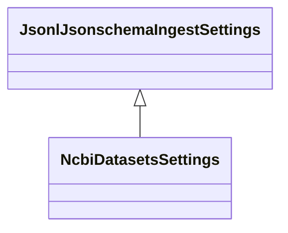

<!-- GENERATED FILE - DO NOT EDIT. Source: `specs/pipelines/jsonlines_jsonschema/`. Regenerate with `uv run python -m scripts.gen_pipeline_spec` or `uv run python -m scripts.gen_converter_spec`. -->

# JSONLines (JSON Schema) Pipeline Specification

This document specifies how an **`ENTITY_SCHEMAS` registry** of JSON Schema documents and the
**JSONLines JSON Schema validation pipeline**
(`cdm_data_loaders.pipelines.jsonlines.extract_jsonschema_validate_pipeline` and `JsonlJsonschemaIngestSettings`)
determine:

1. **Entity schema registration, JSON Schema dialect validation, and PyArrow schema generation** (`JsonlJsonschemaIngestSettings`, `SchemaRegistry`, `build_output_schema_registry`).
2. **Per-line JSON parsing, JSON Schema validation with `FormatChecker`, and dead-letter routing (`_rejected`)** (`iter_file_jsonl_records`, `_make_resolve_error`, `make_page_router`).
3. **Per-entity directory discovery, `.gz` decompression, MD5 sidecar pre-processing, table transforms, and pipeline reporting** (`build_entity_resource`, `run_jsonlines_pipeline`).
4. **Preset subclass behavior** (`ncbi_datasets` / `NcbiDatasetsIngestSettings`).
5. **Errors** (`JsonlJsonschemaError` subclasses) raised for invalid `ENTITY_SCHEMAS` registries or invalid JSON Schemas.

| Property | Value |
| --- | --- |
| **Base Pipeline Family** | `jsonlines_jsonschema` |
| **Base CLI Entry Point** | `jsonlines_jsonschema` |
| **Base Settings Class** | `cdm_data_loaders.pipelines.jsonlines.settings.JsonlJsonschemaIngestSettings` |
| **Pipeline Runner** | `cdm_data_loaders.pipelines.jsonlines.extract_jsonschema_validate_pipeline.run_jsonlines_pipeline` |
| **Preset Subclasses Covered** | `ncbi_datasets` |
| **Specification Directory** | `specs/pipelines/jsonlines_jsonschema/` |

## Settings Class Hierarchy & Preset Subclasses

The generic `jsonlines_jsonschema` pipeline is configured by `JsonlJsonschemaIngestSettings` and executed by `run_jsonlines_pipeline`. Domain preset pipelines subclass the base settings class to lock schema, table, and transform parameters as `ClassVar` constants or narrowed defaults while delegating execution to the same pipeline runner.



### Preset Subclass: `ncbi_datasets` (`NcbiDatasetsSettings`)

- **CLI Command**: `ncbi_datasets`
- **MRO Chain**: `NcbiDatasetsSettings` -> `JsonlJsonschemaIngestSettings`
- **Shared Runner**: `cdm_data_loaders.pipelines.jsonlines.extract_jsonschema_validate_pipeline.run_jsonlines_pipeline`

| Setting / Class Attribute | Override Kind | Base (`JsonlJsonschemaIngestSettings`) | Preset (`NcbiDatasetsSettings`) |
| --- | --- | --- | --- |
| `transforms_module` | Locked `ClassVar` (CLI flag removed) | `None` | `'cdm_data_loaders.schemas.ncbi_datasets.ncbi_openapi'` |
| `output_schemas_module` | Locked `ClassVar` (CLI flag removed) | `None` | `'cdm_data_loaders.schemas.ncbi_datasets.ncbi_openapi'` |
| `dataset_name` | Locked `ClassVar` (CLI flag removed) | *(required)* | `'ncbi_datasets'` |
| `entity_schemas` | Locked `ClassVar` (CLI flag removed) | *(required)* | `'cdm_data_loaders.schemas.ncbi_datasets.ncbi_openapi'` |

## Running Smoke Tests Across Environments

```bash
# Run all base and preset smoke tests for jsonlines_jsonschema across built-in environments
uv run pytest tests/cdm_data_loaders/pipelines/test_pipeline_smoke_spec.py --smoke-pipeline jsonlines_jsonschema

# Run only the ncbi_datasets preset subclass smoke tests
uv run pytest tests/cdm_data_loaders/pipelines/test_pipeline_smoke_spec.py --smoke-pipeline ncbi_datasets

# Run against a custom environment directory (config.toml, secrets.toml, settings.toml)
uv run pytest tests/cdm_data_loaders/pipelines/test_pipeline_smoke_spec.py \
    --smoke-pipeline jsonlines_jsonschema \
    --dlt-config-dir /path/to/env_dlt_config \
    --settings-file /path/to/env_dlt_config/settings.toml
```

---

## 1. Conversion & Pipeline Rules

### 1.1 Entity Schema Registry, Dialects, and PyArrow Schema Generation

<a id="r-jsonl-entity-registry"></a>

- **R-JSONL-ENTITY-REGISTRY**: `JsonlJsonschemaIngestSettings` imports `ENTITY_SCHEMAS: dict[str, dict[str, Any]]` from the module named
  by `entity_schemas` via `load_registry_dict` (**E1** `InvalidEntitySchemasRegistryError` when the module
  cannot be imported, `ENTITY_SCHEMAS` is missing/empty/non-dict, or uses the reserved `_rejected` key).

  *Cases:* [`spec/01_scalars_nested_types_and_extra_fields`](#case-spec-01-scalars-nested-types-and-extra-fields), [`spec/04_multi_entity_gzip_and_subdirs`](#case-spec-04-multi-entity-gzip-and-subdirs), [`presets/ncbi_datasets/01_valid_and_filtered`](#case-presets-ncbi-datasets-01-valid-and-filtered), [`presets/ncbi_datasets/02_rejected_records`](#case-presets-ncbi-datasets-02-rejected-records)

<a id="r-jsonl-schema-convert"></a>

- **R-JSONL-SCHEMA-CONVERT**: Each entry in `ENTITY_SCHEMAS` is validated by `ValidatedSchema`, requiring an explicit `$schema` keyword
  for a supported draft (**E2** `UnsupportedJsonlSchemaDialectError`) and passing `validator.check_schema`
  (**E3** `InvalidJsonlEntitySchemaError`). For each entity not overridden by `TABLE_TRANSFORMS` or
  `OUTPUT_SCHEMAS`, `convert_schema_to_pyarrow` dereferences local `$ref` pointers and `allOf` branches via
  `dereference_schema` (**E4** `UnresolvableJsonlSchemaRefError`) and converts the dereferenced Draft 2020-12
  `object` schema to a `pa.Schema` via `JSONSchemaToPyArrow` (**E5** `UnsupportedJsonlArrowSchemaError`).

  *Cases:* [`spec/01_scalars_nested_types_and_extra_fields`](#case-spec-01-scalars-nested-types-and-extra-fields), [`spec/02_defs_ref_allof_and_draft_dialects`](#case-spec-02-defs-ref-allof-and-draft-dialects)

<a id="r-jsonl-schema-skip"></a>

- **R-JSONL-SCHEMA-SKIP**: When `transforms_module` defines a `RecordTransformFn` for an entity in `TABLE_TRANSFORMS` (or provides an
  explicit `pa.Schema` in `OUTPUT_SCHEMAS`), `build_output_schema_registry` skips automatic
  `convert_schema_to_pyarrow` conversion for that entity and uses `OUTPUT_SCHEMAS` for target table coercion.

  *Cases:* [`spec/06_table_transforms_and_output_schemas`](#case-spec-06-table-transforms-and-output-schemas)

| Declared `$schema` URI | Validator Class | Format Checking |
| :--- | :--- | :--- |
| `https://json-schema.org/draft/2020-12/schema` | `Draft202012Validator` | `FormatChecker()` enabled |
| `https://json-schema.org/draft/2019-09/schema` | `Draft201909Validator` | `FormatChecker()` enabled |
| `http://json-schema.org/draft-07/schema#` | `Draft7Validator` | `FormatChecker()` enabled |
| `http://json-schema.org/draft-06/schema#` | `Draft6Validator` | `FormatChecker()` enabled |
| `http://json-schema.org/draft-04/schema#` | `Draft4Validator` | `FormatChecker()` enabled |
| `https://json-schema.kbase.us/draft/2020-12-xsv/schema` | `Validator` | `FormatChecker()` enabled |

### 1.2 Line Streaming, JSON Schema Validation, and PyArrow Coercion

<a id="r-jsonl-dialect-format"></a>

- **R-JSONL-DIALECT-FORMAT**: `_make_resolve_error` builds a `jsonschema` validator for each entity's raw schema using
  `validator_for(raw_schema)(raw_schema, format_checker=FormatChecker())`, enforcing string `format`
  constraints (such as `date`, `date-time`, `email`, and `uuid`) during record validation while
  `coerce_record_for_pyarrow` parses `format: "date"` strings into `pa.date32()` (`datetime.date`) and keeps
  other formatted strings as `pa.string()`.

  *Cases:* [`spec/02_defs_ref_allof_and_draft_dialects`](#case-spec-02-defs-ref-allof-and-draft-dialects), [`spec/03_blank_lines_parse_errors_and_format_rejections`](#case-spec-03-blank-lines-parse-errors-and-format-rejections)

<a id="r-jsonl-blank-and-reject"></a>

- **R-JSONL-BLANK-AND-REJECT**: `iter_file_jsonl_records` reads each file line-by-line with 1-based line numbering and skips blank or
  whitespace-only lines. Lines that fail `json.loads` (`parse_error = str(e)`) or fail `validator.iter_errors`
  (`error_detail = json.dumps([error.message for error in errors])`, sorted by `str(error)`) are routed by
  `make_page_router` to `_rejected` (`REJECTED_PYARROW_SCHEMA`) with `table_name`, `source_file` (relative
  path `<entity_type>/<file>`), `line_no`, `raw_record`, and `error_detail`.

  *Cases:* [`spec/03_blank_lines_parse_errors_and_format_rejections`](#case-spec-03-blank-lines-parse-errors-and-format-rejections), [`presets/ncbi_datasets/02_rejected_records`](#case-presets-ncbi-datasets-02-rejected-records)

<a id="r-jsonl-coerce"></a>

- **R-JSONL-COERCE**: Valid records are passed through `route_and_coerce_record` into
  `DictBuffer(max_items=settings.buffer_size, schema_map=settings.schema_map)` to emit `pa.Table` pages.
  Undeclared extra fields permitted by the JSON Schema are dropped by PyArrow schema projection, and omitted
  optional fields are populated with `null`.

  *Cases:* [`spec/01_scalars_nested_types_and_extra_fields`](#case-spec-01-scalars-nested-types-and-extra-fields)

### 1.3 Per-Entity Discovery, Pre-processors, Dead-Letter Routing, and Transforms

<a id="r-jsonl-multi-entity-glob"></a>

- **R-JSONL-MULTI-ENTITY-GLOB**: For each `table_name` in `ENTITY_SCHEMAS`, `build_entity_resource` scans `<input_dir>/<table_name>/<file_glob>`
  (default `"*.jsonl*"`). Entities without matching files or subdirectories produce no rows; matching plain
  `.jsonl` and gzip-compressed `.jsonl.gz` files across nested subdirectories are transparently decompressed
  and streamed.

  *Cases:* [`spec/04_multi_entity_gzip_and_subdirs`](#case-spec-04-multi-entity-gzip-and-subdirs)

<a id="r-jsonl-preprocess-md5"></a>

- **R-JSONL-PREPROCESS-MD5**: When `preprocessors_module` configures `FILE_PREPROCESSORS`, `preprocess_file` validates each discovered
  `FileItemDict` before reading lines. If a pre-processor raises an exception (such as a mismatched or
  malformed `<file>.md5` sidecar), the file is skipped and a row is emitted to `_rejected` with `table_name`,
  `source_file` (relative path), `line_no=None`, `raw_record=None`, and `error_detail`.

  *Cases:* [`spec/05_md5_sidecar_preprocessing`](#case-spec-05-md5-sidecar-preprocessing)

<a id="r-jsonl-transforms"></a>

- **R-JSONL-TRANSFORMS**: When `transforms_module` defines `TABLE_TRANSFORMS`, validated record dicts for that entity are passed to
  its `RecordTransformFn`, which may drop records (`{}`), compute derived fields, or fan out records across
  multiple destination tables coerced with `OUTPUT_SCHEMAS`.

  *Cases:* [`spec/06_table_transforms_and_output_schemas`](#case-spec-06-table-transforms-and-output-schemas), [`presets/ncbi_datasets/01_valid_and_filtered`](#case-presets-ncbi-datasets-01-valid-and-filtered)

<a id="r-jsonl-report"></a>

- **R-JSONL-REPORT**: Every pipeline execution writes one audit row to `_load_info` and a YAML summary to
  `<output_dir>/report.txt` recording `status`, `ingested_files` (relative paths `<entity_type>/<file>`),
  `load_errors`, and `pipeline_load_info_errs`.

  *Cases:* [`spec/03_blank_lines_parse_errors_and_format_rejections`](#case-spec-03-blank-lines-parse-errors-and-format-rejections), [`spec/06_table_transforms_and_output_schemas`](#case-spec-06-table-transforms-and-output-schemas), [`presets/ncbi_datasets/01_valid_and_filtered`](#case-presets-ncbi-datasets-01-valid-and-filtered), [`presets/ncbi_datasets/02_rejected_records`](#case-presets-ncbi-datasets-02-rejected-records)

| Column | PyArrow `DataType` | `Field.nullable` | Description |
| :--- | :--- | :--- | :--- |
| `table_name` | `pa.string()` | `True` | Target entity table name (`None` for level-mode file pre-processor errors) |
| `source_file` | `pa.string()` | `True` | Input file path relative to `input_dir` |
| `line_no` | `pa.int64()` | `True` | 1-based physical line number in `source_file` (`None` for file-level errors) |
| `raw_record` | `pa.string()` | `True` | Stripped raw input line (`None` for file-level errors) |
| `error_detail` | `pa.string()` | `True` | Parser error message, JSON-encoded list of schema errors, or pre-processor error |

### 1.4 NCBI Datasets Preset Subclass (`NcbiDatasetsIngestSettings`)

<a id="r-ncbi-preset"></a>

- **R-NCBI-PRESET**: `NcbiDatasetsIngestSettings` (`ncbi_datasets` CLI) subclasses `JsonlJsonschemaIngestSettings`,
  locking `dataset_name="ncbi_datasets"`, `entity_schemas="cdm_data_loaders.parsers.ncbi_datasets"`,
  `transforms_module="cdm_data_loaders.parsers.ncbi_datasets"`,
  `output_schemas_module="cdm_data_loaders.parsers.ncbi_datasets"`, and precomputed `SCHEMAS` for
  `annotation_report` and `dataset_report`.

  *Cases:* [`presets/ncbi_datasets/01_valid_and_filtered`](#case-presets-ncbi-datasets-01-valid-and-filtered), [`presets/ncbi_datasets/02_rejected_records`](#case-presets-ncbi-datasets-02-rejected-records)

<a id="r-ncbi-filter-empty"></a>

- **R-NCBI-FILTER-EMPTY**: `filter_annotation_report` in `cdm_data_loaders.parsers.ncbi_datasets` drops `annotation_report`
  records whose `reports` list is missing or empty (such as `{"total_count": 0}`) before buffering,
  retaining only records with a non-empty `reports` list.

  *Cases:* [`presets/ncbi_datasets/01_valid_and_filtered`](#case-presets-ncbi-datasets-01-valid-and-filtered), [`presets/ncbi_datasets/02_rejected_records`](#case-presets-ncbi-datasets-02-rejected-records)

---

## 2. Case Coverage Matrix

| Suite | Target CLI | Settings Class | Case | Title | Rules | Expected Table Counts |
| --- | --- | --- | --- | --- | --- | --- |
| `spec` | `jsonlines_jsonschema` | `JsonlJsonschemaIngestSettings` | [`01_scalars_nested_types_and_extra_fields`](#case-spec-01-scalars-nested-types-and-extra-fields) | Scalar Types, Nested Objects, Arrays, and Undeclared Extra Fields | [`R-JSONL-ENTITY-REGISTRY`](#r-jsonl-entity-registry), [`R-JSONL-SCHEMA-CONVERT`](#r-jsonl-schema-convert), [`R-JSONL-COERCE`](#r-jsonl-coerce) | `default`: `{'genomes': 2}` |
| `spec` | `jsonlines_jsonschema` | `JsonlJsonschemaIngestSettings` | [`02_defs_ref_allof_and_draft_dialects`](#case-spec-02-defs-ref-allof-and-draft-dialects) | Local `$defs` / `$ref` Dereferencing, `allOf` Composition, and Format Validation | [`R-JSONL-SCHEMA-CONVERT`](#r-jsonl-schema-convert), [`R-JSONL-DIALECT-FORMAT`](#r-jsonl-dialect-format) | `default`: `{'submissions': 2}` |
| `spec` | `jsonlines_jsonschema` | `JsonlJsonschemaIngestSettings` | [`03_blank_lines_parse_errors_and_format_rejections`](#case-spec-03-blank-lines-parse-errors-and-format-rejections) | Blank Lines, JSON Parse Errors, Schema Violations, and `FormatChecker` Rejections | [`R-JSONL-BLANK-AND-REJECT`](#r-jsonl-blank-and-reject), [`R-JSONL-DIALECT-FORMAT`](#r-jsonl-dialect-format), [`R-JSONL-REPORT`](#r-jsonl-report) | `partial_rejections`: `{'contacts': 2, '_rejected': 4}`; `total_rejection`: `{'_rejected': 2}` |
| `spec` | `jsonlines_jsonschema` | `JsonlJsonschemaIngestSettings` | [`04_multi_entity_gzip_and_subdirs`](#case-spec-04-multi-entity-gzip-and-subdirs) | Multi-Entity Subdirectory Discovery, Gzip Decompression, and Missing Entity Directories | [`R-JSONL-MULTI-ENTITY-GLOB`](#r-jsonl-multi-entity-glob), [`R-JSONL-ENTITY-REGISTRY`](#r-jsonl-entity-registry) | `default`: `{'projects': 2, 'experiments': 1}` |
| `spec` | `jsonlines_jsonschema` | `JsonlJsonschemaIngestSettings` | [`05_md5_sidecar_preprocessing`](#case-spec-05-md5-sidecar-preprocessing) | MD5 Sidecar Pre-processing and File-Level `_rejected` Routing | [`R-JSONL-PREPROCESS-MD5`](#r-jsonl-preprocess-md5) | `partial_md5_failure`: `{'articles': 1, '_rejected': 1}`; `total_md5_failure`: `{'_rejected': 1}` |
| `spec` | `jsonlines_jsonschema` | `JsonlJsonschemaIngestSettings` | [`06_table_transforms_and_output_schemas`](#case-spec-06-table-transforms-and-output-schemas) | Table Transforms, Schema Conversion Skip, and Multi-Table Fan-Out | [`R-JSONL-SCHEMA-SKIP`](#r-jsonl-schema-skip), [`R-JSONL-TRANSFORMS`](#r-jsonl-transforms), [`R-JSONL-REPORT`](#r-jsonl-report) | `default`: `{'samples': 2, 'sample_measurements': 2}` |
| `presets/ncbi_datasets` | `ncbi_datasets` | `NcbiDatasetsSettings` | [`01_valid_and_filtered`](#case-presets-ncbi-datasets-01-valid-and-filtered) | Valid Records and Empty Annotation Report Filtering | [`R-JSONL-ENTITY-REGISTRY`](#r-jsonl-entity-registry), [`R-JSONL-TRANSFORMS`](#r-jsonl-transforms), [`R-JSONL-REPORT`](#r-jsonl-report), [`R-NCBI-PRESET`](#r-ncbi-preset), [`R-NCBI-FILTER-EMPTY`](#r-ncbi-filter-empty) | `default`: `{'annotation_report': 1, 'dataset_report': 1}` |
| `presets/ncbi_datasets` | `ncbi_datasets` | `NcbiDatasetsSettings` | [`02_rejected_records`](#case-presets-ncbi-datasets-02-rejected-records) | Malformed JSON and Schema-Invalid Record Rejection (`_rejected`) | [`R-JSONL-ENTITY-REGISTRY`](#r-jsonl-entity-registry), [`R-JSONL-BLANK-AND-REJECT`](#r-jsonl-blank-and-reject), [`R-JSONL-REPORT`](#r-jsonl-report), [`R-NCBI-PRESET`](#r-ncbi-preset), [`R-NCBI-FILTER-EMPTY`](#r-ncbi-filter-empty) | `mixed_valid_and_invalid`: `{'annotation_report': 1, 'dataset_report': 1, '_rejected': 2}` |

---

## 3. Base Pipeline Specification Cases (`jsonlines_jsonschema` / `spec/`)

**Shared Fixture Module (`specs/pipelines/jsonlines_jsonschema/sample_registry.py`)**

```python
"""Entity schema registry for JSONLines (JSON Schema) base pipeline specification cases."""

import json
from pathlib import Path
from typing import Any

SPEC_DIR = Path(__file__).parent / "spec"


def _load_schema(rel_path: str) -> dict[str, Any]:
    return json.loads((SPEC_DIR / rel_path).read_text(encoding="utf-8"))


ENTITY_SCHEMAS: dict[str, dict[str, Any]] = {
    "genomes": _load_schema("01_scalars_nested_types_and_extra_fields/schema.json"),
    "submissions": _load_schema("02_defs_ref_allof_and_draft_dialects/schema.json"),
    "contacts": _load_schema("03_blank_lines_parse_errors_and_format_rejections/schema.json"),
    "projects": _load_schema("04_multi_entity_gzip_and_subdirs/schema.json"),
    "experiments": _load_schema("04_multi_entity_gzip_and_subdirs/experiment_schema.json"),
    "missing_entity": _load_schema("04_multi_entity_gzip_and_subdirs/schema.json"),
    "articles": _load_schema("05_md5_sidecar_preprocessing/schema.json"),
}
```

**Shared Fixture Module (`specs/pipelines/jsonlines_jsonschema/transforms.py`)**

```python
"""Entity schema registries, file pre-processors, table transforms, and output schemas for JSONLines spec cases."""

import json
from pathlib import Path
from typing import Any, Final

import pyarrow as pa

from cdm_data_loaders.core.preprocessors import validate_md5_sidecar
from cdm_data_loaders.core.registry import FilePreprocessFn, RecordTransformFn

SPEC_DIR = Path(__file__).parent / "spec"
NEUTRAL_PH: Final[float] = 7.0

FILE_PREPROCESSORS: tuple[FilePreprocessFn, ...] = (validate_md5_sidecar,)

SAMPLE_SUMMARY_SCHEMA = pa.schema(
    [
        pa.field("sample_id", pa.string(), nullable=False),
        pa.field("ph", pa.float64(), nullable=False),
        pa.field("ph_bucket", pa.string(), nullable=False),
    ]
)

SAMPLE_MEASUREMENT_SCHEMA = pa.schema(
    [
        pa.field("sample_id", pa.string(), nullable=False),
        pa.field("metric", pa.string(), nullable=False),
    ]
)


def transform_sample(row: dict[str, Any]) -> dict[str, list[dict[str, Any]]]:
    """Drop excluded samples, bucket pH values, and fan out metrics to ``sample_measurements``."""
    if row.get("exclude") is True:
        return {}
    sample_id = str(row["sample_id"]).upper()
    ph = float(row["ph"])
    ph_bucket = "acidic" if ph < NEUTRAL_PH else "neutral_or_basic"
    routed: dict[str, list[dict[str, Any]]] = {
        "samples": [
            {
                "sample_id": sample_id,
                "ph": ph,
                "ph_bucket": ph_bucket,
            }
        ]
    }
    metrics = row.get("metrics") or []
    if metrics:
        routed["sample_measurements"] = [{"sample_id": sample_id, "metric": str(m)} for m in metrics]
    return routed


ENTITY_SCHEMAS: dict[str, dict[str, Any]] = {
    "samples": json.loads((SPEC_DIR / "06_table_transforms_and_output_schemas" / "schema.json").read_text("utf-8")),
}

TABLE_TRANSFORMS: dict[str, RecordTransformFn] = {
    "samples": transform_sample,
}

OUTPUT_SCHEMAS: dict[str, pa.Schema] = {
    "samples": SAMPLE_SUMMARY_SCHEMA,
    "sample_measurements": SAMPLE_MEASUREMENT_SCHEMA,
}
```

<a id="case-spec-01-scalars-nested-types-and-extra-fields"></a>

### Scalar Types, Nested Objects, Arrays, and Undeclared Extra Fields (`spec/01_scalars_nested_types_and_extra_fields`)

**Rules:** [R-JSONL-ENTITY-REGISTRY](#r-jsonl-entity-registry), [R-JSONL-SCHEMA-CONVERT](#r-jsonl-schema-convert), [R-JSONL-COERCE](#r-jsonl-coerce)

- `ENTITY_SCHEMAS["genomes"]` maps `string`, `integer`, `number`, `boolean`, nullable `["string", "null"]`, `array` (`pa.list_`), and nested `object` (`pa.struct`) properties to `EXPECTED_SCHEMA`.
- Undeclared extra fields in input records (`extra_note`) are dropped during PyArrow table coercion, and omitted optional fields (`tags`, `assembly_stats`) are populated with `null`.

#### Schema (`schema.json`)

```json
{
  "$schema": "https://json-schema.org/draft/2020-12/schema",
  "title": "GenomeRecord",
  "type": "object",
  "required": ["genome_id", "contig_count", "gc_content", "is_complete"],
  "properties": {
    "genome_id": {
      "type": "string"
    },
    "contig_count": {
      "type": "integer"
    },
    "gc_content": {
      "type": "number"
    },
    "is_complete": {
      "type": "boolean"
    },
    "strain": {
      "type": ["string", "null"]
    },
    "tags": {
      "type": "array",
      "items": {
        "type": "string"
      }
    },
    "assembly_stats": {
      "type": "object",
      "required": ["n50"],
      "properties": {
        "n50": {
          "type": "integer"
        },
        "source_lab": {
          "type": "string"
        }
      }
    }
  }
}
```

#### Input (`data.jsonl`)

```json
{"genome_id": "GCF_0001", "contig_count": 1, "gc_content": 50.8, "is_complete": true, "strain": "K-12", "tags": ["reference", "gut"], "assembly_stats": {"n50": 4641652, "source_lab": "NCBI"}, "extra_note": "dropped by PyArrow schema"}
{"genome_id": "GCF_0002", "contig_count": 42, "gc_content": 38.2, "is_complete": false, "strain": null}
```

#### Converted rows: run `default` (`entity_type=genomes`)

```json
[
  {
    "assembly_stats": {
      "n50": 4641652,
      "source_lab": "NCBI"
    },
    "contig_count": 1,
    "gc_content": 50.8,
    "genome_id": "GCF_0001",
    "is_complete": true,
    "strain": "K-12",
    "tags": [
      "reference",
      "gut"
    ]
  },
  {
    "assembly_stats": null,
    "contig_count": 42,
    "gc_content": 38.2,
    "genome_id": "GCF_0002",
    "is_complete": false,
    "strain": null,
    "tags": null
  }
]
```

#### PyArrow schema ([`expected_schema.py`](https://github.com/kbase/cdm-data-loaders/blob/develop/specs/pipelines/jsonlines_jsonschema/spec/01_scalars_nested_types_and_extra_fields/expected_schema.py))

```python
"""Expected PyArrow schema for 01_scalars_nested_types_and_extra_fields."""

import pyarrow as pa

EXPECTED_SCHEMA = pa.schema(
    [
        pa.field("genome_id", pa.string(), nullable=False, metadata={"jsonschema_type": "string"}),
        pa.field("contig_count", pa.int64(), nullable=False, metadata={"jsonschema_type": "integer"}),
        pa.field("gc_content", pa.float64(), nullable=False, metadata={"jsonschema_type": "number"}),
        pa.field("is_complete", pa.bool_(), nullable=False, metadata={"jsonschema_type": "boolean"}),
        pa.field("strain", pa.string(), nullable=True, metadata={"jsonschema_type": "string"}),
        pa.field(
            "tags",
            pa.list_(pa.field("item", pa.string(), nullable=False, metadata={"jsonschema_type": "string"})),
            nullable=True,
        ),
        pa.field(
            "assembly_stats",
            pa.struct(
                [
                    pa.field("n50", pa.int64(), nullable=False, metadata={"jsonschema_type": "integer"}),
                    pa.field("source_lab", pa.string(), nullable=True, metadata={"jsonschema_type": "string"}),
                ]
            ),
            nullable=True,
        ),
    ]
)
```

---

<a id="case-spec-02-defs-ref-allof-and-draft-dialects"></a>

### Local `$defs` / `$ref` Dereferencing, `allOf` Composition, and Format Validation (`spec/02_defs_ref_allof_and_draft_dialects`)

**Rules:** [R-JSONL-SCHEMA-CONVERT](#r-jsonl-schema-convert), [R-JSONL-DIALECT-FORMAT](#r-jsonl-dialect-format)

- `schema.json` declares local `$defs` definitions (`#/$defs/base_id`, `#/$defs/contact_info`) and top-level `allOf` composition.
- `dereference_schema` merges the `allOf` branches and resolves `$ref` pointers before `JSONSchemaToPyArrow` builds `EXPECTED_SCHEMA`.
- `_make_resolve_error` validates `submitted_date` (`format: "date"`) and `contact.email` (`format: "email"`) with `FormatChecker()`, while `coerce_record_for_pyarrow` parses `submitted_date` into `pa.date32()` (`datetime.date`) and keeps `contact.email` as `pa.string()`.

#### Schema (`schema.json`)

```json
{
  "$schema": "https://json-schema.org/draft/2020-12/schema",
  "title": "SampleSubmission",
  "$defs": {
    "base_id": {
      "type": "object",
      "required": ["submission_id"],
      "properties": {
        "submission_id": {
          "type": "string"
        }
      }
    },
    "contact_info": {
      "type": "object",
      "required": ["email"],
      "properties": {
        "email": {
          "type": "string",
          "format": "email"
        },
        "orcid": {
          "type": "string"
        }
      }
    }
  },
  "allOf": [
    {
      "$ref": "#/$defs/base_id"
    },
    {
      "type": "object",
      "required": ["submitted_date", "contact"],
      "properties": {
        "submitted_date": {
          "type": "string",
          "format": "date"
        },
        "contact": {
          "$ref": "#/$defs/contact_info"
        }
      }
    }
  ]
}
```

#### Input (`data.jsonl`)

```json
{"submission_id": "SUB-01", "submitted_date": "2025-03-15", "contact": {"email": "pi@university.edu", "orcid": "0000-0001-2345-6789"}}
{"submission_id": "SUB-02", "submitted_date": "2025-03-16", "contact": {"email": "curator@institute.org"}}
```

#### Converted rows: run `default` (`entity_type=submissions`)

```json
[
  {
    "contact": {
      "email": "pi@university.edu",
      "orcid": "0000-0001-2345-6789"
    },
    "submission_id": "SUB-01",
    "submitted_date": "2025-03-15"
  },
  {
    "contact": {
      "email": "curator@institute.org",
      "orcid": null
    },
    "submission_id": "SUB-02",
    "submitted_date": "2025-03-16"
  }
]
```

#### PyArrow schema ([`expected_schema.py`](https://github.com/kbase/cdm-data-loaders/blob/develop/specs/pipelines/jsonlines_jsonschema/spec/02_defs_ref_allof_and_draft_dialects/expected_schema.py))

```python
"""Expected PyArrow schema for 02_defs_ref_allof_and_draft_dialects."""

import pyarrow as pa

EXPECTED_SCHEMA = pa.schema(
    [
        pa.field("submission_id", pa.string(), nullable=False, metadata={"jsonschema_type": "string"}),
        pa.field("submitted_date", pa.date32(), nullable=False, metadata={"jsonschema_type": "string (date)"}),
        pa.field(
            "contact",
            pa.struct(
                [
                    pa.field("email", pa.string(), nullable=False, metadata={"jsonschema_type": "string (email)"}),
                    pa.field("orcid", pa.string(), nullable=True, metadata={"jsonschema_type": "string"}),
                ]
            ),
            nullable=False,
        ),
    ]
)
```

---

<a id="case-spec-03-blank-lines-parse-errors-and-format-rejections"></a>

### Blank Lines, JSON Parse Errors, Schema Violations, and `FormatChecker` Rejections (`spec/03_blank_lines_parse_errors_and_format_rejections`)

**Rules:** [R-JSONL-BLANK-AND-REJECT](#r-jsonl-blank-and-reject), [R-JSONL-DIALECT-FORMAT](#r-jsonl-dialect-format), [R-JSONL-REPORT](#r-jsonl-report)

- `iter_file_jsonl_records` skips blank/whitespace-only lines (line 2 of `data.jsonl`) while preserving 1-based physical line numbers (`line_no`).
- Malformed JSON lines (line 3), non-object JSON arrays (line 4), type mismatches (line 5), and `format: "email"` violations (line 6) are routed to `_rejected` (`REJECTED_PYARROW_SCHEMA`).
- Run `total_rejection` verifies that when all lines in a file fail validation, only `_rejected` is created.

#### Schema (`schema.json`)

```json
{
  "$schema": "https://json-schema.org/draft/2020-12/schema",
  "title": "ContactRecord",
  "type": "object",
  "required": ["id", "count", "contact_email"],
  "properties": {
    "id": {
      "type": "string"
    },
    "count": {
      "type": "integer"
    },
    "contact_email": {
      "type": "string",
      "format": "email"
    }
  }
}
```

#### Input (`data.jsonl`)

```json
{"id": "rec-1", "count": 5, "contact_email": "alice@example.org"}
   
{bad json
[1, 2, 3]
{"id": "rec-2", "count": "not-an-int", "contact_email": "bob@example.org"}
{"id": "rec-3", "count": 10, "contact_email": "not-an-email"}
{"id": "rec-4", "count": 12, "contact_email": "carol@example.org"}
```

#### Converted rows: run `partial_rejections` (`entity_type=contacts`)

```json
[
  {
    "contact_email": "alice@example.org",
    "count": 5,
    "id": "rec-1"
  },
  {
    "contact_email": "carol@example.org",
    "count": 12,
    "id": "rec-4"
  }
]
```

#### Rejected rows (`_rejected`): run `partial_rejections` (`entity_type=contacts`)

```json
[
  {
    "error_detail": "Expecting property name enclosed in double quotes: line 1 column 2 (char 1)",
    "line_no": 3,
    "raw_record": "{bad json",
    "source_file": "contacts/data.jsonl",
    "table_name": "contacts"
  },
  {
    "error_detail": "[\"[1, 2, 3] is not of type 'object'\"]",
    "line_no": 4,
    "raw_record": "[1, 2, 3]",
    "source_file": "contacts/data.jsonl",
    "table_name": "contacts"
  },
  {
    "error_detail": "[\"'not-an-int' is not of type 'integer'\"]",
    "line_no": 5,
    "raw_record": "{\"id\": \"rec-2\", \"count\": \"not-an-int\", \"contact_email\": \"bob@example.org\"}",
    "source_file": "contacts/data.jsonl",
    "table_name": "contacts"
  },
  {
    "error_detail": "[\"'not-an-email' is not a 'email'\"]",
    "line_no": 6,
    "raw_record": "{\"id\": \"rec-3\", \"count\": 10, \"contact_email\": \"not-an-email\"}",
    "source_file": "contacts/data.jsonl",
    "table_name": "contacts"
  }
]
```

#### Input (`data_all_invalid.jsonl`)

```json
{unclosed
{"id": "rec-9", "count": "bad", "contact_email": "valid@example.org"}
```

#### Converted rows: run `total_rejection` (`entity_type=contacts`)

```json
[]
```

#### Rejected rows (`_rejected`): run `total_rejection` (`entity_type=contacts`)

```json
[
  {
    "error_detail": "Expecting property name enclosed in double quotes: line 1 column 2 (char 1)",
    "line_no": 1,
    "raw_record": "{unclosed",
    "source_file": "contacts/data_all_invalid.jsonl",
    "table_name": "contacts"
  },
  {
    "error_detail": "[\"'bad' is not of type 'integer'\"]",
    "line_no": 2,
    "raw_record": "{\"id\": \"rec-9\", \"count\": \"bad\", \"contact_email\": \"valid@example.org\"}",
    "source_file": "contacts/data_all_invalid.jsonl",
    "table_name": "contacts"
  }
]
```

#### PyArrow schema ([`expected_schema.py`](https://github.com/kbase/cdm-data-loaders/blob/develop/specs/pipelines/jsonlines_jsonschema/spec/03_blank_lines_parse_errors_and_format_rejections/expected_schema.py))

```python
"""Expected PyArrow schema for 03_blank_lines_parse_errors_and_format_rejections."""

import pyarrow as pa

EXPECTED_SCHEMA = pa.schema(
    [
        pa.field("id", pa.string(), nullable=False, metadata={"jsonschema_type": "string"}),
        pa.field("count", pa.int64(), nullable=False, metadata={"jsonschema_type": "integer"}),
        pa.field("contact_email", pa.string(), nullable=False, metadata={"jsonschema_type": "string (email)"}),
    ]
)
```

---

<a id="case-spec-04-multi-entity-gzip-and-subdirs"></a>

### Multi-Entity Subdirectory Discovery, Gzip Decompression, and Missing Entity Directories (`spec/04_multi_entity_gzip_and_subdirs`)

**Rules:** [R-JSONL-MULTI-ENTITY-GLOB](#r-jsonl-multi-entity-glob), [R-JSONL-ENTITY-REGISTRY](#r-jsonl-entity-registry)

- `ENTITY_SCHEMAS` registers three entities: `projects`, `experiments`, and `missing_entity`.
- `data/` contains `projects/part1.jsonl`, `projects/nested/part2.jsonl.gz` (recursively matched by `file_glob="**/*.jsonl*"`), and `experiments/exp1.jsonl`, while `missing_entity/` is absent and skipped without error.

#### Schema (`schema.json`)

```json
{
  "$schema": "https://json-schema.org/draft/2020-12/schema",
  "title": "ProjectRecord",
  "type": "object",
  "required": ["project_id", "name"],
  "properties": {
    "project_id": {
      "type": "string"
    },
    "name": {
      "type": "string"
    }
  }
}
```

#### Input (`data/experiments/exp1.jsonl`)

```json
{"exp_id": "EXP-10", "project_id": "PRJ-1", "reads": 250000}
```

#### Input (`data/projects/nested/part2.jsonl.gz`)

```json
{"project_id": "PRJ-2", "name": "Marine Virome"}
```

#### Input (`data/projects/part1.jsonl`)

```json
{"project_id": "PRJ-1", "name": "Soil Metagenome"}
```

#### Converted rows: run `default` (`entity_type=projects`, `file_glob=**/*.jsonl*`, `extra_entities={'experiments': 'experiment_schema.json', 'missing_entity': 'schema.json'}`)

```json
[
  {
    "name": "Marine Virome",
    "project_id": "PRJ-2"
  },
  {
    "name": "Soil Metagenome",
    "project_id": "PRJ-1"
  }
]
```

#### Converted rows (`experiments`): run `default` (`entity_type=projects`, `file_glob=**/*.jsonl*`, `extra_entities={'experiments': 'experiment_schema.json', 'missing_entity': 'schema.json'}`)

```json
[
  {
    "exp_id": "EXP-10",
    "project_id": "PRJ-1",
    "reads": 250000
  }
]
```

#### PyArrow schema ([`expected_schema.py`](https://github.com/kbase/cdm-data-loaders/blob/develop/specs/pipelines/jsonlines_jsonschema/spec/04_multi_entity_gzip_and_subdirs/expected_schema.py))

```python
"""Expected PyArrow schemas for 04_multi_entity_gzip_and_subdirs."""

import pyarrow as pa

PROJECTS_SCHEMA = pa.schema(
    [
        pa.field("project_id", pa.string(), nullable=False, metadata={"jsonschema_type": "string"}),
        pa.field("name", pa.string(), nullable=False, metadata={"jsonschema_type": "string"}),
    ]
)

EXPERIMENTS_SCHEMA = pa.schema(
    [
        pa.field("exp_id", pa.string(), nullable=False, metadata={"jsonschema_type": "string"}),
        pa.field("project_id", pa.string(), nullable=False, metadata={"jsonschema_type": "string"}),
        pa.field("reads", pa.int64(), nullable=False, metadata={"jsonschema_type": "integer"}),
    ]
)

EXPECTED_SCHEMA = PROJECTS_SCHEMA
EXPECTED_SCHEMAS = {
    "projects": PROJECTS_SCHEMA,
    "experiments": EXPERIMENTS_SCHEMA,
    "missing_entity": PROJECTS_SCHEMA,
}
```

---

<a id="case-spec-05-md5-sidecar-preprocessing"></a>

### MD5 Sidecar Pre-processing and File-Level `_rejected` Routing (`spec/05_md5_sidecar_preprocessing`)

**Rules:** [R-JSONL-PREPROCESS-MD5](#r-jsonl-preprocess-md5)

- `preprocessors_module="specs.pipelines.jsonlines_jsonschema.transforms"` registers `validate_md5_sidecar`.
- Run `partial_md5_failure` ingests `articles/good.jsonl` and rejects `articles/bad.jsonl` due to a digest mismatch in `articles/bad.jsonl.md5`, emitting a file-level row (`line_no=None`, `raw_record=None`) to `_rejected`.
- Run `total_md5_failure` rejects `articles/malformed.jsonl` due to invalid sidecar syntax in `articles/malformed.jsonl.md5`, leaving `articles` uncreated.

#### Schema (`schema.json`)

```json
{
  "$schema": "https://json-schema.org/draft/2020-12/schema",
  "title": "ArticleRecord",
  "type": "object",
  "required": ["pmid", "title"],
  "properties": {
    "pmid": {
      "type": "integer"
    },
    "title": {
      "type": "string"
    }
  }
}
```

#### Input (`data_partial/articles/bad.jsonl`)

```json
{"pmid": 2002, "title": "Corrupted Sidecar Article"}
```

#### Input (`data_partial/articles/bad.jsonl.md5`)

```text
MD5(bad.jsonl)= 00000000000000000000000000000000
```

#### Input (`data_partial/articles/good.jsonl`)

```json
{"pmid": 2001, "title": "Validated JSONL Article"}
```

#### Input (`data_partial/articles/good.jsonl.md5`)

```text
MD5(good.jsonl)= dc8b98a9d2a35e768b29ccba604e32ae
```

#### Converted rows: run `partial_md5_failure` (`entity_type=articles`, `file_glob=*.jsonl`, `preprocessors_module=specs.pipelines.jsonlines_jsonschema.transforms`)

```json
[
  {
    "pmid": 2001,
    "title": "Validated JSONL Article"
  }
]
```

#### Rejected rows (`_rejected`): run `partial_md5_failure` (`entity_type=articles`, `file_glob=*.jsonl`, `preprocessors_module=specs.pipelines.jsonlines_jsonschema.transforms`)

```json
[
  {
    "error_detail": "MD5 mismatch for articles/bad.jsonl: expected 00000000000000000000000000000000, got d7400ffc422f33a13f8edec2834cf6e1",
    "line_no": null,
    "raw_record": null,
    "source_file": "articles/bad.jsonl",
    "table_name": "articles"
  }
]
```

#### Input (`data_total_failure/articles/malformed.jsonl`)

```json
{"pmid": 2003, "title": "Malformed Sidecar Article"}
```

#### Input (`data_total_failure/articles/malformed.jsonl.md5`)

```text
not-a-valid-md5-line
```

#### Converted rows: run `total_md5_failure` (`entity_type=articles`, `file_glob=*.jsonl`, `preprocessors_module=specs.pipelines.jsonlines_jsonschema.transforms`)

```json
[]
```

#### Rejected rows (`_rejected`): run `total_md5_failure` (`entity_type=articles`, `file_glob=*.jsonl`, `preprocessors_module=specs.pipelines.jsonlines_jsonschema.transforms`)

```json
[
  {
    "error_detail": "Invalid MD5 sidecar content for articles/malformed.jsonl: 'not-a-valid-md5-line'",
    "line_no": null,
    "raw_record": null,
    "source_file": "articles/malformed.jsonl",
    "table_name": "articles"
  }
]
```

#### PyArrow schema ([`expected_schema.py`](https://github.com/kbase/cdm-data-loaders/blob/develop/specs/pipelines/jsonlines_jsonschema/spec/05_md5_sidecar_preprocessing/expected_schema.py))

```python
"""Expected PyArrow schema for 05_md5_sidecar_preprocessing."""

import pyarrow as pa

EXPECTED_SCHEMA = pa.schema(
    [
        pa.field("pmid", pa.int64(), nullable=False, metadata={"jsonschema_type": "integer"}),
        pa.field("title", pa.string(), nullable=False, metadata={"jsonschema_type": "string"}),
    ]
)
```

---

<a id="case-spec-06-table-transforms-and-output-schemas"></a>

### Table Transforms, Schema Conversion Skip, and Multi-Table Fan-Out (`spec/06_table_transforms_and_output_schemas`)

**Rules:** [R-JSONL-SCHEMA-SKIP](#r-jsonl-schema-skip), [R-JSONL-TRANSFORMS](#r-jsonl-transforms), [R-JSONL-REPORT](#r-jsonl-report)

- `transforms_module="specs.pipelines.jsonlines_jsonschema.transforms"` defines `TABLE_TRANSFORMS["samples"] = transform_sample` and `OUTPUT_SCHEMAS` for `samples` and `sample_measurements`.
- `build_output_schema_registry` skips `convert_schema_to_pyarrow` for `samples` (allowing input-only `anyOf` fields such as `raw_payload` in `schema.json` to validate input lines without raising `E5`).
- `transform_sample` drops `exclude=True` rows, uppercases `sample_id`, computes `ph_bucket`, and fans out `metrics` to `sample_measurements`.

#### Schema (`schema.json`)

```json
{
  "$schema": "https://json-schema.org/draft/2020-12/schema",
  "title": "SampleRecord",
  "type": "object",
  "required": ["sample_id", "ph"],
  "properties": {
    "sample_id": {
      "type": "string"
    },
    "ph": {
      "type": "number"
    },
    "exclude": {
      "type": "boolean"
    },
    "metrics": {
      "type": "array",
      "items": {
        "type": "string"
      }
    },
    "raw_payload": {
      "anyOf": [
        {"type": "string"},
        {"type": "integer"}
      ]
    }
  }
}
```

#### Input (`data.jsonl`)

```json
{"sample_id": "smp-1", "ph": 6.4, "metrics": ["moisture", "salinity"], "raw_payload": "note"}
{"sample_id": "smp-2", "ph": 7.1, "exclude": true, "metrics": ["ignored"], "raw_payload": 42}
{"sample_id": "smp-3", "ph": 7.8}
```

#### Converted rows: run `default` (`entity_type=samples`, `entity_schemas=specs.pipelines.jsonlines_jsonschema.transforms`, `transforms_module=specs.pipelines.jsonlines_jsonschema.transforms`, `output_schemas_module=specs.pipelines.jsonlines_jsonschema.transforms`)

```json
[
  {
    "ph": 6.4,
    "ph_bucket": "acidic",
    "sample_id": "SMP-1"
  },
  {
    "ph": 7.8,
    "ph_bucket": "neutral_or_basic",
    "sample_id": "SMP-3"
  }
]
```

#### Converted rows (`sample_measurements`): run `default` (`entity_type=samples`, `entity_schemas=specs.pipelines.jsonlines_jsonschema.transforms`, `transforms_module=specs.pipelines.jsonlines_jsonschema.transforms`, `output_schemas_module=specs.pipelines.jsonlines_jsonschema.transforms`)

```json
[
  {
    "metric": "moisture",
    "sample_id": "SMP-1"
  },
  {
    "metric": "salinity",
    "sample_id": "SMP-1"
  }
]
```

#### PyArrow schema ([`expected_schema.py`](https://github.com/kbase/cdm-data-loaders/blob/develop/specs/pipelines/jsonlines_jsonschema/spec/06_table_transforms_and_output_schemas/expected_schema.py))

```python
"""Expected PyArrow schemas for 06_table_transforms_and_output_schemas."""

import pyarrow as pa

SAMPLE_SUMMARY_SCHEMA = pa.schema(
    [
        pa.field("sample_id", pa.string(), nullable=False),
        pa.field("ph", pa.float64(), nullable=False),
        pa.field("ph_bucket", pa.string(), nullable=False),
    ]
)

SAMPLE_MEASUREMENT_SCHEMA = pa.schema(
    [
        pa.field("sample_id", pa.string(), nullable=False),
        pa.field("metric", pa.string(), nullable=False),
    ]
)

EXPECTED_SCHEMA = SAMPLE_SUMMARY_SCHEMA
EXPECTED_SCHEMAS = {
    "samples": SAMPLE_SUMMARY_SCHEMA,
    "sample_measurements": SAMPLE_MEASUREMENT_SCHEMA,
}
```

---

## 4. Preset Subclass Specification Cases (`presets/`)

<a id="case-presets-ncbi-datasets-01-valid-and-filtered"></a>

### Valid Records and Empty Annotation Report Filtering (`presets/ncbi_datasets/01_valid_and_filtered`)

**Suite:** `presets/ncbi_datasets` · **Target CLI:** `ncbi_datasets` · **Settings Class:** `NcbiDatasetsSettings`  
**Directory:** `specs/pipelines/jsonlines_jsonschema/presets/ncbi_datasets/01_valid_and_filtered/`  
**Rules:** [`R-JSONL-ENTITY-REGISTRY`](#r-jsonl-entity-registry), [`R-JSONL-TRANSFORMS`](#r-jsonl-transforms), [`R-JSONL-REPORT`](#r-jsonl-report), [`R-NCBI-PRESET`](#r-ncbi-preset), [`R-NCBI-FILTER-EMPTY`](#r-ncbi-filter-empty)

Loads `annotation_report/annotations.jsonl` (one empty response `{"total_count": 0}` dropped by
`filter_annotation_report`, and one populated annotation report retained) alongside
`dataset_report/dataset_reports.jsonl` (one assembly dataset report).

**Settings (`specs/pipelines/jsonlines_jsonschema/presets/ncbi_datasets/01_valid_and_filtered/settings.toml`)**

```toml
loader_file_format = "parquet"
use_output_dir_for_pipeline_metadata = true
```

**Input `annotation_report/annotations.jsonl` (`specs/pipelines/jsonlines_jsonschema/presets/ncbi_datasets/01_valid_and_filtered/input/annotation_report/annotations.jsonl`)**

```json
{"total_count":0}
{"reports":[{"annotation":{"annotations":[{"assembly_accession":"GCA_000234645.4"}],"gene_type":"protein-coding","genomic_regions":[{"gene_range":{"accession_version":"JF734911.1","range":[{"begin":"562","end":"1713","orientation":"plus"}]}}],"name":"integrase/recombinase","proteins":[{"accession_version":"AET85156.1","length":383,"name":"integrase/recombinase"}],"symbol":"int"},"row_id":"1"}],"total_count":1}
```

**Input `dataset_report/dataset_reports.jsonl` (`specs/pipelines/jsonlines_jsonschema/presets/ncbi_datasets/01_valid_and_filtered/input/dataset_report/dataset_reports.jsonl`)**

```json
{"accession":"GCA_018350175.1","current_accession":"GCA_018350175.1","paired_accession":"GCF_018350175.1","source_database":"SOURCE_DATABASE_GENBANK","organism":{"tax_id":9685,"organism_name":"Felis catus","common_name":"domestic cat","infraspecific_names":{"isolate":"Fca126","sex":"female"}},"assembly_info":{"assembly_level":"Chromosome","assembly_status":"current","assembly_name":"F.catus_Fca126_mat1.0","assembly_type":"haploid","bioproject_accession":"PRJNA684600","release_date":"2021-05-13","submitter":"Texas A&M University","refseq_category":"reference genome","sequencing_tech":"PacBio Sequel 2","assembly_method":"NextDenovo v. 2.2-beta.0"},"assembly_stats":{"total_number_of_chromosomes":19,"total_sequence_length":"2425730029","number_of_contigs":109,"contig_n50":90731473,"contig_l50":10,"gc_percent":42.0},"wgs_info":{"wgs_project_accession":"JAFEKA01"}}
```

**Expected `report.txt` Summary & Row Counts (`{'annotation_report': 1, 'dataset_report': 1}`)**

```yaml
status: completed
ingested_files:
- annotation_report/annotations.jsonl
- dataset_report/dataset_reports.jsonl
load_errors: []
pipeline_load_info_errs: null
```

**Expected PyArrow Tables (`specs/pipelines/jsonlines_jsonschema/presets/ncbi_datasets/01_valid_and_filtered/expected_tables.py` — `EXPECTED_TABLES`)**

```python
"""Expected PyArrow tables for ncbi_datasets 01_valid_and_filtered."""

import pyarrow as pa

from cdm_data_loaders.schemas.ncbi_datasets.schema import (
    ANNOTATION_REPORT_SCHEMA,
    DATASET_REPORT_SCHEMA,
)

EXPECTED_TABLES: dict[str, pa.Table] = {
    "annotation_report": pa.Table.from_pylist(
        [
            {
                "reports": [
                    {
                        "annotation": {
                            "annotations": [{"assembly_accession": "GCA_000234645.4"}],
                            "gene_type": "protein-coding",
                            "genomic_regions": [
                                {
                                    "gene_range": {
                                        "accession_version": "JF734911.1",
                                        "range": [{"begin": "562", "end": "1713", "orientation": "plus"}],
                                    }
                                }
                            ],
                            "name": "integrase/recombinase",
                            "proteins": [
                                {
                                    "accession_version": "AET85156.1",
                                    "length": 383,
                                    "name": "integrase/recombinase",
                                }
                            ],
                            "symbol": "int",
                        },
                        "row_id": "1",
                    }
                ],
                "total_count": 1,
            }
        ],
        schema=ANNOTATION_REPORT_SCHEMA,
    ),
    "dataset_report": pa.Table.from_pylist(
        [
            {
                "accession": "GCA_018350175.1",
                "current_accession": "GCA_018350175.1",
                "paired_accession": "GCF_018350175.1",
                "source_database": "SOURCE_DATABASE_GENBANK",
                "organism": {
                    "tax_id": 9685,
                    "organism_name": "Felis catus",
                    "common_name": "domestic cat",
                    "infraspecific_names": {"isolate": "Fca126", "sex": "female"},
                },
                "assembly_info": {
                    "assembly_level": "Chromosome",
                    "assembly_status": "current",
                    "assembly_name": "F.catus_Fca126_mat1.0",
                    "assembly_type": "haploid",
                    "bioproject_accession": "PRJNA684600",
                    "release_date": "2021-05-13",
                    "submitter": "Texas A&M University",
                    "refseq_category": "reference genome",
                    "sequencing_tech": "PacBio Sequel 2",
                    "assembly_method": "NextDenovo v. 2.2-beta.0",
                },
                "assembly_stats": {
                    "total_number_of_chromosomes": 19,
                    "total_sequence_length": "2425730029",
                    "number_of_contigs": 109,
                    "contig_n50": 90731473,
                    "contig_l50": 10,
                    "gc_percent": 42.0,
                },
                "wgs_info": {"wgs_project_accession": "JAFEKA01"},
            }
        ],
        schema=DATASET_REPORT_SCHEMA,
    ),
}
```

**Expected Canonical Table Rows (`specs/pipelines/jsonlines_jsonschema/presets/ncbi_datasets/01_valid_and_filtered/expected.json`)**

```json
{
  "annotation_report": [
    {
      "reports": [
        {
          "annotation": {
            "annotations": [
              {
                "assembly_accession": "GCA_000234645.4"
              }
            ],
            "gene_type": "protein-coding",
            "genomic_regions": [
              {
                "gene_range": {
                  "accession_version": "JF734911.1",
                  "range": [
                    {
                      "begin": "562",
                      "end": "1713",
                      "orientation": "plus"
                    }
                  ]
                }
              }
            ],
            "name": "integrase/recombinase",
            "proteins": [
              {
                "accession_version": "AET85156.1",
                "length": 383,
                "name": "integrase/recombinase"
              }
            ],
            "symbol": "int"
          },
          "row_id": "1"
        }
      ],
      "total_count": 1
    }
  ],
  "dataset_report": [
    {
      "accession": "GCA_018350175.1",
      "assembly_info": {
        "assembly_level": "Chromosome",
        "assembly_method": "NextDenovo v. 2.2-beta.0",
        "assembly_name": "F.catus_Fca126_mat1.0",
        "assembly_status": "current",
        "assembly_type": "haploid",
        "bioproject_accession": "PRJNA684600",
        "refseq_category": "reference genome",
        "release_date": "2021-05-13",
        "sequencing_tech": "PacBio Sequel 2",
        "submitter": "Texas A&M University"
      },
      "assembly_stats": {
        "contig_l50": 10,
        "contig_n50": 90731473,
        "gc_percent": 42.0,
        "number_of_contigs": 109,
        "total_number_of_chromosomes": 19,
        "total_sequence_length": "2425730029"
      },
      "current_accession": "GCA_018350175.1",
      "organism": {
        "common_name": "domestic cat",
        "infraspecific_names": {
          "isolate": "Fca126",
          "sex": "female"
        },
        "organism_name": "Felis catus",
        "tax_id": 9685
      },
      "paired_accession": "GCF_018350175.1",
      "source_database": "SOURCE_DATABASE_GENBANK",
      "wgs_info": {
        "wgs_project_accession": "JAFEKA01"
      }
    }
  ]
}
```

---

<a id="case-presets-ncbi-datasets-02-rejected-records"></a>

### Malformed JSON and Schema-Invalid Record Rejection (`_rejected`) (`presets/ncbi_datasets/02_rejected_records`)

**Suite:** `presets/ncbi_datasets` · **Target CLI:** `ncbi_datasets` · **Settings Class:** `NcbiDatasetsSettings`  
**Directory:** `specs/pipelines/jsonlines_jsonschema/presets/ncbi_datasets/02_rejected_records/`  
**Rules:** [`R-JSONL-ENTITY-REGISTRY`](#r-jsonl-entity-registry), [`R-JSONL-BLANK-AND-REJECT`](#r-jsonl-blank-and-reject), [`R-JSONL-REPORT`](#r-jsonl-report), [`R-NCBI-PRESET`](#r-ncbi-preset), [`R-NCBI-FILTER-EMPTY`](#r-ncbi-filter-empty)

Mixed valid, filtered, schema-invalid, and malformed JSON lines across `annotation_report/batch.jsonl`
and `dataset_report/batch.jsonl`. Valid records load into their target tables, empty `reports` rows are
discarded, and invalid lines route to `_rejected` with line-level provenance.

**Settings (`specs/pipelines/jsonlines_jsonschema/presets/ncbi_datasets/02_rejected_records/settings.toml`)**

```toml
loader_file_format = "parquet"
use_output_dir_for_pipeline_metadata = true
```

**Input `annotation_report/batch.jsonl` (`specs/pipelines/jsonlines_jsonschema/presets/ncbi_datasets/02_rejected_records/input/annotation_report/batch.jsonl`)**

```json
{"total_count":0}
{"reports":[{"annotation":{"name":"integrase/recombinase","symbol":"int"},"row_id":"1"}],"total_count":1}
{"total_count":"not-an-int"}
```

**Input `dataset_report/batch.jsonl` (`specs/pipelines/jsonlines_jsonschema/presets/ncbi_datasets/02_rejected_records/input/dataset_report/batch.jsonl`)**

```json
{"accession":"GCF_000005845.2","source_database":"SOURCE_DATABASE_REFSEQ"}
{malformed json
```

**Expected `report.txt` Summary & Row Counts (`{'annotation_report': 1, 'dataset_report': 1, '_rejected': 2}`)**

```yaml
status: completed
ingested_files:
- annotation_report/batch.jsonl
- dataset_report/batch.jsonl
load_errors: []
pipeline_load_info_errs: null
```

**Expected PyArrow Tables (`specs/pipelines/jsonlines_jsonschema/presets/ncbi_datasets/02_rejected_records/expected_tables.py` — `EXPECTED_TABLES`)**

```python
"""Expected PyArrow tables for ncbi_datasets 02_rejected_records."""

import pyarrow as pa

from cdm_data_loaders.schemas.ncbi_datasets.schema import (
    ANNOTATION_REPORT_SCHEMA,
    DATASET_REPORT_SCHEMA,
)
from cdm_data_loaders.utils.buffer import REJECTED_PYARROW_SCHEMA

EXPECTED_TABLES: dict[str, pa.Table] = {
    "annotation_report": pa.Table.from_pylist(
        [
            {
                "reports": [
                    {
                        "annotation": {"name": "integrase/recombinase", "symbol": "int"},
                        "row_id": "1",
                    }
                ],
                "total_count": 1,
            }
        ],
        schema=ANNOTATION_REPORT_SCHEMA,
    ),
    "dataset_report": pa.Table.from_pylist(
        [
            {
                "accession": "GCF_000005845.2",
                "source_database": "SOURCE_DATABASE_REFSEQ",
            }
        ],
        schema=DATASET_REPORT_SCHEMA,
    ),
    "_rejected": pa.Table.from_pylist(
        [
            {
                "table_name": "annotation_report",
                "source_file": "annotation_report/batch.jsonl",
                "line_no": 3,
                "raw_record": '{"total_count":"not-an-int"}',
                "error_detail": "[\"'not-an-int' is not of type 'integer'\"]",
            },
            {
                "table_name": "dataset_report",
                "source_file": "dataset_report/batch.jsonl",
                "line_no": 2,
                "raw_record": "{malformed json",
                "error_detail": "Expecting property name enclosed in double quotes: line 1 column 2 (char 1)",
            },
        ],
        schema=REJECTED_PYARROW_SCHEMA,
    ),
}
```

**Expected Canonical Table Rows (`specs/pipelines/jsonlines_jsonschema/presets/ncbi_datasets/02_rejected_records/expected.json`)**

```json
{
  "_rejected": [
    {
      "error_detail": "[\"'not-an-int' is not of type 'integer'\"]",
      "line_no": 3,
      "raw_record": "{\"total_count\":\"not-an-int\"}",
      "source_file": "annotation_report/batch.jsonl",
      "table_name": "annotation_report"
    },
    {
      "error_detail": "Expecting property name enclosed in double quotes: line 1 column 2 (char 1)",
      "line_no": 2,
      "raw_record": "{malformed json",
      "source_file": "dataset_report/batch.jsonl",
      "table_name": "dataset_report"
    }
  ],
  "annotation_report": [
    {
      "reports": [
        {
          "annotation": {
            "name": "integrase/recombinase",
            "symbol": "int"
          },
          "row_id": "1"
        }
      ],
      "total_count": 1
    }
  ],
  "dataset_report": [
    {
      "accession": "GCF_000005845.2",
      "source_database": "SOURCE_DATABASE_REFSEQ"
    }
  ]
}
```

---

## 5. Errors (Unsupported / Invalid Input)

Schema generation raises a subclass of `JsonlJsonschemaError` (itself a `RuntimeError`).

| Code | Exception | Condition | Reason | Fixtures |
| :--- | :--- | :--- | :--- | :--- |
| **E1** | `InvalidEntitySchemasRegistryError` | Invalid or empty ENTITY_SCHEMAS registry | The `entity_schemas` module must define a non-empty `ENTITY_SCHEMAS` dictionary and cannot use the reserved `_rejected` table name. | [`01_empty_entity_schemas.json`](https://github.com/kbase/cdm-data-loaders/blob/develop/specs/pipelines/jsonlines_jsonschema/spec/errors/01_empty_entity_schemas.json): `ENTITY_SCHEMAS` is an empty dictionary.<br>[`02_reserved_rejected_table_name.json`](https://github.com/kbase/cdm-data-loaders/blob/develop/specs/pipelines/jsonlines_jsonschema/spec/errors/02_reserved_rejected_table_name.json): `ENTITY_SCHEMAS` uses the reserved `_rejected` table name. |
| **E2** | `UnsupportedJsonlSchemaDialectError` | Missing or unsupported JSON Schema $schema dialect | Every entity JSON Schema must declare a supported `$schema` draft URI (Draft 4, 6, 7, 2019-09, 2020-12, or KBase 2020-12-xsv). | [`03_missing_schema_keyword.json`](https://github.com/kbase/cdm-data-loaders/blob/develop/specs/pipelines/jsonlines_jsonschema/spec/errors/03_missing_schema_keyword.json): Entity JSON Schema omits the required `$schema` keyword.<br>[`04_unsupported_schema_draft.json`](https://github.com/kbase/cdm-data-loaders/blob/develop/specs/pipelines/jsonlines_jsonschema/spec/errors/04_unsupported_schema_draft.json): Entity JSON Schema declares an unrecognized `$schema` URI. |
| **E3** | `InvalidJsonlEntitySchemaError` | Entity JSON Schema fails draft metaschema validation | Every entity JSON Schema must be a valid schema document under its declared `$schema` metaschema. | [`05_invalid_property_type_keyword.json`](https://github.com/kbase/cdm-data-loaders/blob/develop/specs/pipelines/jsonlines_jsonschema/spec/errors/05_invalid_property_type_keyword.json): Property schema uses an invalid `type` value rejected by the Draft 2020-12 metaschema.<br>[`06_non_list_required_keyword.json`](https://github.com/kbase/cdm-data-loaders/blob/develop/specs/pipelines/jsonlines_jsonschema/spec/errors/06_non_list_required_keyword.json): `required` is a string instead of an array of property names. |
| **E4** | `UnresolvableJsonlSchemaRefError` | Unresolvable or circular $ref in entity JSON Schema | All `$ref` pointers and `allOf` branches in an entity JSON Schema must resolve without cycles before PyArrow conversion. | [`07_dangling_local_ref.json`](https://github.com/kbase/cdm-data-loaders/blob/develop/specs/pipelines/jsonlines_jsonschema/spec/errors/07_dangling_local_ref.json): Local `$ref` pointer targets a non-existent definition in `$defs`.<br>[`08_circular_ref.json`](https://github.com/kbase/cdm-data-loaders/blob/develop/specs/pipelines/jsonlines_jsonschema/spec/errors/08_circular_ref.json): Self-referential `$ref` cycle in `$defs` fails `dereference_schema`. |
| **E5** | `UnsupportedJsonlArrowSchemaError` | Entity JSON Schema cannot be converted to a PyArrow table schema | Each non-transformed, non-overridden entity JSON Schema must have `type: "object"` with at least one property and only supported PyArrow column constructs. | [`09_non_object_root_type.json`](https://github.com/kbase/cdm-data-loaders/blob/develop/specs/pipelines/jsonlines_jsonschema/spec/errors/09_non_object_root_type.json): Root entity schema has `type: "array"` instead of `type: "object"`.<br>[`10_unsupported_anyof_union.json`](https://github.com/kbase/cdm-data-loaders/blob/develop/specs/pipelines/jsonlines_jsonschema/spec/errors/10_unsupported_anyof_union.json): Incompatible `anyOf` union branches (`array` and `string`) cannot be converted to a PyArrow column type without a table transform or `OUTPUT_SCHEMAS` override. |

## 6. Fixture Index

Every case directory contains a `case.yaml` manifest; the test suites and this document are both driven by it.

| Case | Target CLI | Manifest | Runs |
| :--- | :--- | :--- | :--- |
| [`spec/01_scalars_nested_types_and_extra_fields`](#case-spec-01-scalars-nested-types-and-extra-fields) | `jsonlines_jsonschema` | [`case.yaml`](https://github.com/kbase/cdm-data-loaders/blob/develop/specs/pipelines/jsonlines_jsonschema/spec/01_scalars_nested_types_and_extra_fields/case.yaml) | default |
| [`spec/02_defs_ref_allof_and_draft_dialects`](#case-spec-02-defs-ref-allof-and-draft-dialects) | `jsonlines_jsonschema` | [`case.yaml`](https://github.com/kbase/cdm-data-loaders/blob/develop/specs/pipelines/jsonlines_jsonschema/spec/02_defs_ref_allof_and_draft_dialects/case.yaml) | default |
| [`spec/03_blank_lines_parse_errors_and_format_rejections`](#case-spec-03-blank-lines-parse-errors-and-format-rejections) | `jsonlines_jsonschema` | [`case.yaml`](https://github.com/kbase/cdm-data-loaders/blob/develop/specs/pipelines/jsonlines_jsonschema/spec/03_blank_lines_parse_errors_and_format_rejections/case.yaml) | partial_rejections, total_rejection |
| [`spec/04_multi_entity_gzip_and_subdirs`](#case-spec-04-multi-entity-gzip-and-subdirs) | `jsonlines_jsonschema` | [`case.yaml`](https://github.com/kbase/cdm-data-loaders/blob/develop/specs/pipelines/jsonlines_jsonschema/spec/04_multi_entity_gzip_and_subdirs/case.yaml) | default |
| [`spec/05_md5_sidecar_preprocessing`](#case-spec-05-md5-sidecar-preprocessing) | `jsonlines_jsonschema` | [`case.yaml`](https://github.com/kbase/cdm-data-loaders/blob/develop/specs/pipelines/jsonlines_jsonschema/spec/05_md5_sidecar_preprocessing/case.yaml) | partial_md5_failure, total_md5_failure |
| [`spec/06_table_transforms_and_output_schemas`](#case-spec-06-table-transforms-and-output-schemas) | `jsonlines_jsonschema` | [`case.yaml`](https://github.com/kbase/cdm-data-loaders/blob/develop/specs/pipelines/jsonlines_jsonschema/spec/06_table_transforms_and_output_schemas/case.yaml) | default |
| [`presets/ncbi_datasets/01_valid_and_filtered`](#case-presets-ncbi-datasets-01-valid-and-filtered) | `ncbi_datasets` | [`case.yaml`](https://github.com/kbase/cdm-data-loaders/blob/develop/specs/pipelines/jsonlines_jsonschema/presets/ncbi_datasets/01_valid_and_filtered/case.yaml) | default |
| [`presets/ncbi_datasets/02_rejected_records`](#case-presets-ncbi-datasets-02-rejected-records) | `ncbi_datasets` | [`case.yaml`](https://github.com/kbase/cdm-data-loaders/blob/develop/specs/pipelines/jsonlines_jsonschema/presets/ncbi_datasets/02_rejected_records/case.yaml) | mixed_valid_and_invalid |
