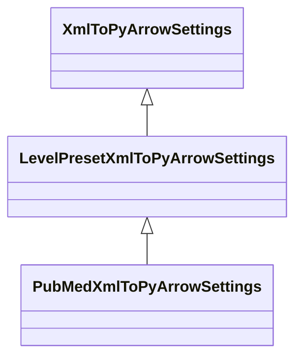

<!-- GENERATED FILE - DO NOT EDIT. Source: `specs/pipelines/xmltopyarrow/`. Regenerate with `uv run python -m scripts.gen_pipeline_spec` or `uv run python -m scripts.gen_converter_spec`. -->

# XML to PyArrow Pipeline Specification

This document specifies how an **XSD schema** and the **XML-to-PyArrow ingestion pipeline**
(`cdm_data_loaders.pipelines.xmltopyarrow` and `cdm_data_loaders.readers.xml`) determine:

1. **Target selection, preset configurations, and PyArrow schema resolution** (`XmlToPyArrowSettings`, `PresetXmlToPyArrowSettings`, `LevelPresetXmlToPyArrowSettings`).
2. **Streaming XML element extraction, default namespace resolution, and XSD-driven PyArrow table coercion** (`process_xml_file_to_pyarrow`).
3. **File discovery, `.gz` decompression, MD5 sidecar pre-processing, dead-letter routing (`_rejected`), table transforms, and pipeline reporting** (`run_xmltopyarrow_pipeline`).
4. **Preset subclass behavior** (`pubmed`, `uniprot`, `uniref50`, `uniref90`, `uniref100`).
5. **Errors** (`XmlToPyArrowConfigError` subclasses) raised for invalid target selection, invalid XSDs, or invalid pipeline hooks.

| Property | Value |
| --- | --- |
| **Base Pipeline Family** | `xmltopyarrow` |
| **Base CLI Entry Point** | `xmltopyarrow` |
| **Base Settings Class** | `cdm_data_loaders.pipelines.xmltopyarrow.settings.XmlToPyArrowSettings` |
| **Pipeline Runner** | `cdm_data_loaders.pipelines.xmltopyarrow.pipeline.run_xmltopyarrow_pipeline` |
| **Preset Subclasses Covered** | `pubmed` |
| **Specification Directory** | `specs/pipelines/xmltopyarrow/` |

## Settings Class Hierarchy & Preset Subclasses

The generic `xmltopyarrow` pipeline is configured by `XmlToPyArrowSettings` and executed by `run_xmltopyarrow_pipeline`. Domain preset pipelines subclass the base settings class to lock schema, table, and transform parameters as `ClassVar` constants or narrowed defaults while delegating execution to the same pipeline runner.



### Preset Subclass: `pubmed` (`PubMedXmlToPyArrowSettings`)

- **CLI Command**: `pubmed`
- **MRO Chain**: `PubMedXmlToPyArrowSettings` -> `LevelPresetXmlToPyArrowSettings` -> `XmlToPyArrowSettings`
- **Shared Runner**: `cdm_data_loaders.pipelines.xmltopyarrow.pipeline.run_xmltopyarrow_pipeline`

| Setting / Class Attribute | Override Kind | Base (`XmlToPyArrowSettings`) | Preset (`PubMedXmlToPyArrowSettings`) |
| --- | --- | --- | --- |
| `dataset_name` | Locked `ClassVar` (CLI flag removed) | *(required)* | `'pubmed'` |
| `file_glob` | Overridden field default | `'*.xml*'` | `'*.xml.gz'` |
| `table_name` | Locked `ClassVar` (CLI flag removed) | `None` | `None` |
| `xml_tag` | Locked `ClassVar` (CLI flag removed) | `None` | `None` |
| `xml_level` | Locked `ClassVar` (CLI flag removed) | `None` | `1` |
| `xsd_file` | Overridden field default | *(required)* | `src/cdm_data_loaders/schemas/pubmed/pubmed.xsd` |
| `_PRECOMPUTED_SCHEMAS` | Preset class binding | `None` | mapping with keys `['DeleteCitation', 'PubmedArticle', 'PubmedBookArticle']` |
| `_DEFAULT_FILE_PREPROCESSORS` | Preset class binding | `None` | `(validate_md5_sidecar,)` |

## Running Smoke Tests Across Environments

```bash
# Run all base and preset smoke tests for xmltopyarrow across built-in environments
uv run pytest tests/cdm_data_loaders/pipelines/test_pipeline_smoke_spec.py --smoke-pipeline xmltopyarrow

# Run only the pubmed preset subclass smoke tests
uv run pytest tests/cdm_data_loaders/pipelines/test_pipeline_smoke_spec.py --smoke-pipeline pubmed

# Run against a custom environment directory (config.toml, secrets.toml, settings.toml)
uv run pytest tests/cdm_data_loaders/pipelines/test_pipeline_smoke_spec.py \
    --smoke-pipeline xmltopyarrow \
    --dlt-config-dir /path/to/env_dlt_config \
    --settings-file /path/to/env_dlt_config/settings.toml
```

---

## 1. Conversion & Pipeline Rules

### 1.1 Target Selection, Presets, and PyArrow Schema Resolution

<a id="r-xml-single-target"></a>

- **R-XML-SINGLE-TARGET**: Single-tag mode (`xml_level` is `None`) requires both `xml_tag` and `table_name` and forbids `root_tag`
  (**E1** `InvalidXmlTargetSelectionError`). `XmlToPyArrowSettings` loads `xsd_file` via `load_schema`
  (**E2** `InvalidXsdDocumentError`) and compiles `make_xml_element_converter(xsd_schema, xml_tag, max_recursion_depth)`
  and `generate_pyarrow_schema(xsd_schema, xml_tag, max_recursion_depth)` (**E3** `XmlTargetNotFoundError`,
  **E4** `UnsupportedXsdTargetError`).

  *Cases:* [`spec/01_single_tag_and_default_namespace`](#case-spec-01-single-tag-and-default-namespace)

<a id="r-xml-level-target"></a>

- **R-XML-LEVEL-TARGET**: Level-based mode (`xml_level >= 1`) forbids `xml_tag` and `table_name` (**E1** `InvalidXmlTargetSelectionError`).
  `XmlToPyArrowSettings` resolves all XSD element declarations at depth `xml_level` relative to `root_tag`
  (or all root elements when `root_tag` is `None`), compiling `make_xml_level_converters` and a `pa.Schema`
  per element tag name via `generate_pyarrow_schemas_at_level`.

  *Cases:* [`spec/03_level_mode_and_root_tag`](#case-spec-03-level-mode-and-root-tag), [`presets/pubmed/01_multi_table_ingest`](#case-presets-pubmed-01-multi-table-ingest)

<a id="r-xml-preset"></a>

- **R-XML-PRESET**: Preset settings classes (`UniProtXmlToPyArrowSettings`, `UniRef50XmlToPyArrowSettings`,
  `UniRef90XmlToPyArrowSettings`, `UniRef100XmlToPyArrowSettings`, and `PubMedXmlToPyArrowSettings`)
  lock target selection and `dataset_name` as `ClassVar` attributes and bind precomputed `pa.Schema`
  objects without re-running XSD schema generation.

  *Cases:* [`spec/04_multi_file_gzip_and_subdirs`](#case-spec-04-multi-file-gzip-and-subdirs), [`spec/05_md5_sidecar_preprocessing_and_rejected`](#case-spec-05-md5-sidecar-preprocessing-and-rejected)

<a id="r-xml-recursion"></a>

- **R-XML-RECURSION**: `max_recursion_depth` (default `2`) bounds self-referential XSD complex types; elements nested deeper
  than `max_recursion_depth` are serialized as JSON strings in a `pa.string()` field rather than
  expanding further struct nesting.

  *Cases:* [`spec/02_self_nested_tags_and_recursion_depth`](#case-spec-02-self-nested-tags-and-recursion-depth)

<a id="r-xml-schema-skip"></a>

- **R-XML-SCHEMA-SKIP**: When `transforms_module` defines a `RecordTransformFn` for a target table (all keys in `TABLE_TRANSFORMS`
  and `FILE_PREPROCESSORS` must match valid table names; **E5** `InvalidXmlPipelineHookError`), automatic
  XSD-to-PyArrow schema generation is skipped for that table unless an explicit `pa.Schema` is provided
  in `OUTPUT_SCHEMAS`.

  *Cases:* [`spec/06_table_transforms_and_output_schemas`](#case-spec-06-table-transforms-and-output-schemas)

| CLI Command | Settings Class | `dataset_name` | Target Selection | `file_glob` | Default Pre-processors |
| :--- | :--- | :--- | :--- | :--- | :--- |
| `xmltopyarrow` | `XmlToPyArrowSettings` | *(required)* | `xml_tag` + `table_name` **or** `xml_level` (+ optional `root_tag`) | `'*.xml*'` | — |
| `uniprot` | `UniProtXmlToPyArrowSettings` | `'uniprot'` (locked) | `xml_tag='entry'`, `table_name='entry'` (locked) | `'*.xml*'` | — |
| `uniref50` | `UniRef50XmlToPyArrowSettings` | `'uniref50'` (locked) | `xml_tag='entry'`, `table_name='entry'` (locked) | `'*.xml*'` | — |
| `uniref90` | `UniRef90XmlToPyArrowSettings` | `'uniref90'` (locked) | `xml_tag='entry'`, `table_name='entry'` (locked) | `'*.xml*'` | — |
| `uniref100` | `UniRef100XmlToPyArrowSettings` | `'uniref100'` (locked) | `xml_tag='entry'`, `table_name='entry'` (locked) | `'*.xml*'` | — |
| `pubmed` | `PubMedXmlToPyArrowSettings` | `'pubmed'` (locked) | `xml_level=1`, `root_tag=None` (locked) | `'*.xml.gz'` | `validate_md5_sidecar` |

### 1.2 XML Streaming, Namespace Resolution, and PyArrow Coercion

<a id="r-xml-default-ns"></a>

- **R-XML-DEFAULT-NS**: In single-tag mode, `parse_head_matter` inspects root namespace declarations before streaming. If the
  document declares a default namespace (`xmlns="..."`) and `xml_tag` is unprefixed, `_stream_elements`
  rewinds the handle and streams `{default_ns}<xml_tag>`; otherwise it streams `xml_tag` directly.

  *Cases:* [`spec/01_single_tag_and_default_namespace`](#case-spec-01-single-tag-and-default-namespace)

<a id="r-xml-outermost"></a>

- **R-XML-OUTERMOST**: In single-tag mode, `stream_xml_file` tracks nesting depth of matching `<xml_tag>` elements and yields
  only the outermost matching element; self-nested `<xml_tag>` descendants remain attached to their
  enclosing element.

  *Cases:* [`spec/02_self_nested_tags_and_recursion_depth`](#case-spec-02-self-nested-tags-and-recursion-depth)

<a id="r-xml-level-stream"></a>

- **R-XML-LEVEL-STREAM**: In level-based mode, `stream_xml_file_at_level` yields every element at depth `xml_level` relative to
  the root element and routes each element to the converter and destination table matching
  `local_name(element.tag)`.

  *Cases:* [`spec/03_level_mode_and_root_tag`](#case-spec-03-level-mode-and-root-tag), [`presets/pubmed/01_multi_table_ingest`](#case-presets-pubmed-01-multi-table-ingest)

<a id="r-xml-coerce"></a>

- **R-XML-COERCE**: Each streamed XML element is converted to a Python dictionary by its XSD converter (`_attr` keys for
  attributes, `#text` for simple content, nested dicts and lists for child elements), routed through
  `route_and_coerce_record`, and accumulated in `DictBuffer(max_items=settings.buffer_size, schema_map=settings.schema_map)`
  to emit `pa.Table` pages conforming to the target `pa.Schema`.

  *Cases:* [`spec/01_single_tag_and_default_namespace`](#case-spec-01-single-tag-and-default-namespace)

### 1.3 File Discovery, Pre-processors, Dead-Letter Routing, and Transforms

<a id="r-xml-glob-gzip"></a>

- **R-XML-GLOB-GZIP**: `run_xmltopyarrow_pipeline` discovers files under `settings.input_dir` matching `settings.file_glob`
  (default `"*.xml*"`, or `"*.xml.gz"` for `pubmed`), transparently decompressing `.gz` files alongside
  plain `.xml` files across subdirectories.

  *Cases:* [`spec/04_multi_file_gzip_and_subdirs`](#case-spec-04-multi-file-gzip-and-subdirs)

<a id="r-xml-preprocess-md5"></a>

- **R-XML-PREPROCESS-MD5**: When file pre-processors are configured (via `preprocessors_module` or `PubMedXmlToPyArrowSettings`'s
  default `validate_md5_sidecar`), each `FileItemDict` is validated before XML parsing. If a pre-processor
  raises an exception (such as a missing or mismatched `<file>.md5` sidecar), the file is skipped and a
  row is emitted to `_rejected` (`REJECTED_PYARROW_SCHEMA`) with `table_name`, `source_file` (relative
  path), `line_no=None`, `raw_record=None`, and `error_detail`.

  *Cases:* [`spec/05_md5_sidecar_preprocessing_and_rejected`](#case-spec-05-md5-sidecar-preprocessing-and-rejected), [`presets/pubmed/02_invalid_md5_sidecar`](#case-presets-pubmed-02-invalid-md5-sidecar)

<a id="r-xml-transforms"></a>

- **R-XML-TRANSFORMS**: When `transforms_module` defines a `RecordTransformFn` for a target table, converted XML element dicts
  are passed to the transform before buffering. The transform may drop records (`{}`), modify fields, or
  fan out records across multiple destination tables, coercing each table with `OUTPUT_SCHEMAS` when
  provided.

  *Cases:* [`spec/06_table_transforms_and_output_schemas`](#case-spec-06-table-transforms-and-output-schemas)

<a id="r-xml-report"></a>

- **R-XML-REPORT**: Every pipeline execution writes one audit row to `_load_info` and a YAML summary to
  `<output_dir>/report.txt` recording `status` (`"completed"` or `"completed with errors"` when
  pre-processing or load errors occur), `ingested_files`, `load_errors`, and `pipeline_load_info_errs`.

  *Cases:* [`spec/01_single_tag_and_default_namespace`](#case-spec-01-single-tag-and-default-namespace), [`spec/03_level_mode_and_root_tag`](#case-spec-03-level-mode-and-root-tag), [`presets/pubmed/01_multi_table_ingest`](#case-presets-pubmed-01-multi-table-ingest), [`presets/pubmed/02_invalid_md5_sidecar`](#case-presets-pubmed-02-invalid-md5-sidecar)

| Column | PyArrow `DataType` | `Field.nullable` | Description |
| :--- | :--- | :--- | :--- |
| `table_name` | `pa.string()` | `True` | Target entity table name (`None` for level-mode file pre-processor errors) |
| `source_file` | `pa.string()` | `True` | Input file path relative to `input_dir` |
| `line_no` | `pa.int64()` | `True` | 1-based physical line number in `source_file` (`None` for file-level errors) |
| `raw_record` | `pa.string()` | `True` | Stripped raw input line (`None` for file-level errors) |
| `error_detail` | `pa.string()` | `True` | Parser error message, JSON-encoded list of schema errors, or pre-processor error |

### 1.4 PubMed Preset Subclass (`PubMedXmlToPyArrowSettings`)

<a id="r-pubmed-preset"></a>

- **R-PUBMED-PRESET**: `PubMedXmlToPyArrowSettings` (`pubmed` CLI) subclasses `LevelPresetXmlToPyArrowSettings` and
  `XmlToPyArrowSettings`, locking `dataset_name="pubmed"`, `xml_level=1`, `root_tag="PubmedArticleSet"`,
  `xsd_file=PUBMED_XSD`, `file_glob="*.xml.gz"`, and precomputed `PUBMED_SCHEMAS` for
  `pubmed_article`, `pubmed_book_article`, and `delete_citation`.

  *Cases:* [`presets/pubmed/01_multi_table_ingest`](#case-presets-pubmed-01-multi-table-ingest), [`presets/pubmed/02_invalid_md5_sidecar`](#case-presets-pubmed-02-invalid-md5-sidecar)

<a id="r-pubmed-md5-pass"></a>

- **R-PUBMED-MD5-PASS**: `PubMedXmlToPyArrowSettings` enables `validate_md5_sidecar` by default in `_DEFAULT_FILE_PREPROCESSORS`,
  verifying each `.xml.gz` file against its `<file>.md5` sidecar before streaming `<PubmedArticle>`,
  `<PubmedBookArticle>`, and `<DeleteCitation>` records into their destination tables.

  *Cases:* [`presets/pubmed/01_multi_table_ingest`](#case-presets-pubmed-01-multi-table-ingest)

<a id="r-pubmed-md5-fail"></a>

- **R-PUBMED-MD5-FAIL**: When a `.xml.gz` file fails `validate_md5_sidecar` in `pubmed`, the file is omitted from
  `ingested_files`, a file-level provenance row (`table_name=None`, `line_no=None`, `raw_record=None`)
  is written to `_rejected`, and `report.txt` records `status: completed with errors` and `load_errors`.

  *Cases:* [`presets/pubmed/02_invalid_md5_sidecar`](#case-presets-pubmed-02-invalid-md5-sidecar)

---

## 2. Case Coverage Matrix

| Suite | Target CLI | Settings Class | Case | Title | Rules | Expected Table Counts |
| --- | --- | --- | --- | --- | --- | --- |
| `spec` | `xmltopyarrow` | `XmlToPyArrowSettings` | [`01_single_tag_and_default_namespace`](#case-spec-01-single-tag-and-default-namespace) | Single-Tag Extraction, Default Namespace Resolution, and PyArrow Coercion | [`R-XML-SINGLE-TARGET`](#r-xml-single-target), [`R-XML-DEFAULT-NS`](#r-xml-default-ns), [`R-XML-COERCE`](#r-xml-coerce), [`R-XML-REPORT`](#r-xml-report) | `default`: `{'catalog_items': 2}` |
| `spec` | `xmltopyarrow` | `XmlToPyArrowSettings` | [`02_self_nested_tags_and_recursion_depth`](#case-spec-02-self-nested-tags-and-recursion-depth) | Self-Nested Target Tags and Configurable `max_recursion_depth` | [`R-XML-OUTERMOST`](#r-xml-outermost), [`R-XML-RECURSION`](#r-xml-recursion) | `depth_2`: `{'categories': 2}`; `depth_1`: `{'categories': 2}` |
| `spec` | `xmltopyarrow` | `XmlToPyArrowSettings` | [`03_level_mode_and_root_tag`](#case-spec-03-level-mode-and-root-tag) | Level-Based Multi-Table Extraction and `root_tag` Anchoring | [`R-XML-LEVEL-TARGET`](#r-xml-level-target), [`R-XML-LEVEL-STREAM`](#r-xml-level-stream), [`R-XML-REPORT`](#r-xml-report) | `level_1`: `{'article': 2, 'retraction': 1}` |
| `spec` | `xmltopyarrow` | `XmlToPyArrowSettings` | [`04_multi_file_gzip_and_subdirs`](#case-spec-04-multi-file-gzip-and-subdirs) | Multi-File Recursive Globbing, Gzip Decompression, and Preset Settings | [`R-XML-PRESET`](#r-xml-preset), [`R-XML-GLOB-GZIP`](#r-xml-glob-gzip) | `default`: `{'entries': 2}` |
| `spec` | `xmltopyarrow` | `XmlToPyArrowSettings` | [`05_md5_sidecar_preprocessing_and_rejected`](#case-spec-05-md5-sidecar-preprocessing-and-rejected) | MD5 Sidecar Pre-processing and `_rejected` Dead-Letter Routing | [`R-XML-PREPROCESS-MD5`](#r-xml-preprocess-md5), [`R-XML-PRESET`](#r-xml-preset) | `partial_md5_failure`: `{'articles': 1, '_rejected': 1}`; `total_md5_failure`: `{'_rejected': 1}` |
| `spec` | `xmltopyarrow` | `XmlToPyArrowSettings` | [`06_table_transforms_and_output_schemas`](#case-spec-06-table-transforms-and-output-schemas) | Table Transforms, Multi-Table Fan-Out, and `OUTPUT_SCHEMAS` | [`R-XML-SCHEMA-SKIP`](#r-xml-schema-skip), [`R-XML-TRANSFORMS`](#r-xml-transforms) | `default`: `{'measurements': 2, 'measurement_tags': 2}` |
| `presets/pubmed` | `pubmed` | `PubMedXmlToPyArrowSettings` | [`01_multi_table_ingest`](#case-presets-pubmed-01-multi-table-ingest) | Multi-Table PubMed Ingest (`PubmedArticle`, `PubmedBookArticle`, `DeleteCitation`) | [`R-XML-LEVEL-TARGET`](#r-xml-level-target), [`R-XML-LEVEL-STREAM`](#r-xml-level-stream), [`R-XML-REPORT`](#r-xml-report), [`R-PUBMED-PRESET`](#r-pubmed-preset), [`R-PUBMED-MD5-PASS`](#r-pubmed-md5-pass) | `default`: `{'pubmed_article': 1, 'pubmed_book_article': 1, 'delete_citation': 1}` |
| `presets/pubmed` | `pubmed` | `PubMedXmlToPyArrowSettings` | [`02_invalid_md5_sidecar`](#case-presets-pubmed-02-invalid-md5-sidecar) | Invalid MD5 Sidecar Rejection (`_rejected` and `load_errors`) | [`R-XML-PREPROCESS-MD5`](#r-xml-preprocess-md5), [`R-XML-REPORT`](#r-xml-report), [`R-PUBMED-PRESET`](#r-pubmed-preset), [`R-PUBMED-MD5-FAIL`](#r-pubmed-md5-fail) | `mismatched_md5`: `{'_rejected': 1}` |

---

## 3. Base Pipeline Specification Cases (`xmltopyarrow` / `spec/`)

**Shared Fixture Module (`specs/pipelines/xmltopyarrow/transforms.py`)**

```python
"""Pre-processors, table transforms, and PyArrow output schemas for XML-to-PyArrow specification cases."""

from typing import Any

import pyarrow as pa

from cdm_data_loaders.core.preprocessors import validate_md5_sidecar
from cdm_data_loaders.core.registry import FilePreprocessFn, RecordTransformFn

FILE_PREPROCESSORS: tuple[FilePreprocessFn, ...] = (validate_md5_sidecar,)

MEASUREMENT_SCHEMA = pa.schema(
    [
        pa.field("sensor_id", pa.string(), nullable=False),
        pa.field("value", pa.float64(), nullable=False),
        pa.field("scaled_value", pa.float64(), nullable=False),
    ]
)

MEASUREMENT_TAG_SCHEMA = pa.schema(
    [
        pa.field("sensor_id", pa.string(), nullable=False),
        pa.field("tag", pa.string(), nullable=False),
    ]
)


def transform_measurement(row: dict[str, Any]) -> dict[str, list[dict[str, Any]]]:
    """Drop draft measurements, compute ``scaled_value``, and fan out tags to ``measurement_tags``."""
    if row.get("_status") == "drop":
        return {}
    sensor_id = str(row["_id"]).upper()
    value = float(row["value"])
    routed: dict[str, list[dict[str, Any]]] = {
        "measurements": [
            {
                "sensor_id": sensor_id,
                "value": value,
                "scaled_value": round(value * 10.0, 2),
            }
        ]
    }
    tags = row.get("tag") or []
    if tags:
        routed["measurement_tags"] = [{"sensor_id": sensor_id, "tag": str(t)} for t in tags]
    return routed


TABLE_TRANSFORMS: dict[str, RecordTransformFn] = {
    "measurements": transform_measurement,
}

OUTPUT_SCHEMAS: dict[str, pa.Schema] = {
    "measurements": MEASUREMENT_SCHEMA,
    "measurement_tags": MEASUREMENT_TAG_SCHEMA,
}
```

<a id="case-spec-01-single-tag-and-default-namespace"></a>

### Single-Tag Extraction, Default Namespace Resolution, and PyArrow Coercion (`spec/01_single_tag_and_default_namespace`)

**Rules:** [R-XML-SINGLE-TARGET](#r-xml-single-target), [R-XML-DEFAULT-NS](#r-xml-default-ns), [R-XML-COERCE](#r-xml-coerce), [R-XML-REPORT](#r-xml-report)

**Target:** `xml_tag='item'`

- `schema.xsd` declares `targetNamespace="http://example.org/catalog"`, while `xml_tag` is configured as unprefixed `"item"` and `table_name="catalog_items"`.
- `parse_head_matter` reads `xmlns="http://example.org/catalog"` from the root `<catalog>` element and rewinds the stream to match `{http://example.org/catalog}item`.
- Each `<item>` element is converted into a nested dictionary (`_id`, `_active`, `name`, `quantity`, `price`, `released`, `notes`, and `tag`) and buffered into a `pa.Table` conforming to `EXPECTED_SCHEMA`.

#### Schema (`schema.xsd`)

```xml
<?xml version="1.0" encoding="UTF-8"?>
<xs:schema xmlns:xs="http://www.w3.org/2001/XMLSchema"
           targetNamespace="http://example.org/catalog"
           xmlns:cat="http://example.org/catalog"
           elementFormDefault="qualified">
  <xs:element name="catalog">
    <xs:complexType>
      <xs:sequence>
        <xs:element name="item" type="cat:ItemType" maxOccurs="unbounded"/>
      </xs:sequence>
    </xs:complexType>
  </xs:element>

  <xs:complexType name="ItemType">
    <xs:sequence>
      <xs:element name="name" type="xs:string">
        <xs:annotation>
          <xs:documentation>Display name of the catalog item.</xs:documentation>
        </xs:annotation>
      </xs:element>
      <xs:element name="quantity" type="xs:integer"/>
      <xs:element name="price" type="xs:double"/>
      <xs:element name="released" type="xs:date" minOccurs="0"/>
      <xs:element name="notes" type="xs:string" minOccurs="0" nillable="true"/>
      <xs:element name="tag" type="xs:string" minOccurs="0" maxOccurs="unbounded"/>
    </xs:sequence>
    <xs:attribute name="id" type="xs:string" use="required"/>
    <xs:attribute name="active" type="xs:boolean" use="required"/>
  </xs:complexType>
</xs:schema>
```

#### Input (`data.xml`)

```xml
<?xml version="1.0" encoding="UTF-8"?>
<catalog xmlns="http://example.org/catalog"
         xmlns:xsi="http://www.w3.org/2001/XMLSchema-instance">
  <item id="itm-1" active="true">
    <name>Spectrometer</name>
    <quantity>4</quantity>
    <price>1250.5</price>
    <released>2025-03-15</released>
    <notes>Calibrated</notes>
    <tag>optics</tag>
    <tag>lab</tag>
  </item>
  <item id="itm-2" active="false">
    <name>Centrifuge</name>
    <quantity>1</quantity>
    <price>890.0</price>
    <notes xsi:nil="true"/>
  </item>
</catalog>
```

#### Converted rows: run `default` (`table_name=catalog_items`)

```json
[
  {
    "_id": "itm-1",
    "_active": true,
    "name": "Spectrometer",
    "quantity": 4,
    "price": 1250.5,
    "released": "2025-03-15",
    "notes": "Calibrated",
    "tag": [
      "optics",
      "lab"
    ]
  },
  {
    "_id": "itm-2",
    "_active": false,
    "name": "Centrifuge",
    "quantity": 1,
    "price": 890.0,
    "released": null,
    "notes": null,
    "tag": null
  }
]
```

#### PyArrow schema ([`expected_schema.py`](https://github.com/kbase/cdm-data-loaders/blob/main/specs/pipelines/xmltopyarrow/spec/01_single_tag_and_default_namespace/expected_schema.py))

```python
"""Expected PyArrow schema for 01_single_tag_and_default_namespace (xml_tag='item')."""

import pyarrow as pa

EXPECTED_SCHEMA = pa.schema(
    [
        pa.field("_id", pa.string(), nullable=False, metadata={"xsd_type": "xs:string"}),
        pa.field("_active", pa.bool_(), nullable=False, metadata={"xsd_type": "xs:boolean"}),
        pa.field(
            "name",
            pa.string(),
            nullable=False,
            metadata={"comment": "Display name of the catalog item.", "xsd_type": "xs:string"},
        ),
        pa.field("quantity", pa.int64(), nullable=False, metadata={"xsd_type": "xs:integer"}),
        pa.field("price", pa.float64(), nullable=False, metadata={"xsd_type": "xs:double"}),
        pa.field("released", pa.date32(), nullable=True, metadata={"xsd_type": "xs:date"}),
        pa.field("notes", pa.string(), nullable=True, metadata={"xsd_type": "xs:string"}),
        pa.field(
            "tag",
            pa.list_(
                pa.field("item", pa.string(), nullable=True, metadata={"xsd_type": "xs:string"}),
            ),
            nullable=True,
        ),
    ]
)
```

---

<a id="case-spec-02-self-nested-tags-and-recursion-depth"></a>

### Self-Nested Target Tags and Configurable `max_recursion_depth` (`spec/02_self_nested_tags_and_recursion_depth`)

**Rules:** [R-XML-OUTERMOST](#r-xml-outermost), [R-XML-RECURSION](#r-xml-recursion)

**Target:** `xml_tag='category'`

- `<category>` is both the target `xml_tag` and a self-referential child element inside `CategoryType`.
- `stream_xml_file` tracks open `<category>` depth and yields only the two outermost `<category>` elements (`cat-1` and `cat-2`), keeping nested `<category>` descendants (`cat-1-1`, `cat-1-1-1`) inside `cat-1`.
- Run `depth_2` (default `max_recursion_depth=2`) expands child `<category>` elements as structs and serializes grandchild `<category>` elements as JSON strings; run `depth_1` (`max_recursion_depth=1`) serializes direct child `<category>` elements as JSON strings.

#### Schema (`schema.xsd`)

```xml
<?xml version="1.0" encoding="UTF-8"?>
<xs:schema xmlns:xs="http://www.w3.org/2001/XMLSchema">
  <xs:element name="taxonomy">
    <xs:complexType>
      <xs:sequence>
        <xs:element name="category" type="CategoryType" maxOccurs="unbounded"/>
      </xs:sequence>
    </xs:complexType>
  </xs:element>

  <xs:complexType name="CategoryType">
    <xs:sequence>
      <xs:element name="title" type="xs:string"/>
      <xs:element name="category" type="CategoryType" minOccurs="0" maxOccurs="unbounded"/>
    </xs:sequence>
    <xs:attribute name="id" type="xs:string" use="required"/>
  </xs:complexType>
</xs:schema>
```

#### Input (`data.xml`)

```xml
<?xml version="1.0" encoding="UTF-8"?>
<taxonomy>
  <category id="cat-1">
    <title>Bacteria</title>
    <category id="cat-1-1">
      <title>Proteobacteria</title>
      <category id="cat-1-1-1">
        <title>Gammaproteobacteria</title>
      </category>
    </category>
  </category>
  <category id="cat-2">
    <title>Archaea</title>
  </category>
</taxonomy>
```

#### Converted rows: run `depth_2` (`table_name=categories`, `max_recursion_depth=2`)

```json
[
  {
    "_id": "cat-1",
    "title": "Bacteria",
    "category": [
      {
        "_id": "cat-1-1",
        "title": "Proteobacteria",
        "category": [
          "{\"_id\": \"cat-1-1-1\", \"title\": \"Gammaproteobacteria\"}"
        ]
      }
    ]
  },
  {
    "_id": "cat-2",
    "title": "Archaea",
    "category": null
  }
]
```

#### Converted rows: run `depth_1` (`table_name=categories`, `max_recursion_depth=1`)

```json
[
  {
    "_id": "cat-1",
    "title": "Bacteria",
    "category": [
      "{\"_id\": \"cat-1-1\", \"title\": \"Proteobacteria\", \"category\": [{\"_id\": \"cat-1-1-1\", \"title\": \"Gammaproteobacteria\"}]}"
    ]
  },
  {
    "_id": "cat-2",
    "title": "Archaea",
    "category": null
  }
]
```

#### PyArrow schema ([`expected_schema.py`](https://github.com/kbase/cdm-data-loaders/blob/main/specs/pipelines/xmltopyarrow/spec/02_self_nested_tags_and_recursion_depth/expected_schema.py))

```python
"""Expected PyArrow schemas for 02_self_nested_tags_and_recursion_depth (xml_tag='category')."""

import pyarrow as pa

EXPECTED_SCHEMA = pa.schema(
    [
        pa.field("_id", pa.string(), nullable=False, metadata={"xsd_type": "xs:string"}),
        pa.field("title", pa.string(), nullable=False, metadata={"xsd_type": "xs:string"}),
        pa.field(
            "category",
            pa.list_(
                pa.field(
                    "item",
                    pa.struct(
                        [
                            pa.field("_id", pa.string(), nullable=False, metadata={"xsd_type": "xs:string"}),
                            pa.field("title", pa.string(), nullable=False, metadata={"xsd_type": "xs:string"}),
                            pa.field(
                                "category",
                                pa.list_(
                                    pa.field("item", pa.string(), nullable=True),
                                ),
                                nullable=True,
                            ),
                        ]
                    ),
                    nullable=True,
                ),
            ),
            nullable=True,
        ),
    ]
)

EXPECTED_SCHEMA_DEPTH_1 = pa.schema(
    [
        pa.field("_id", pa.string(), nullable=False, metadata={"xsd_type": "xs:string"}),
        pa.field("title", pa.string(), nullable=False, metadata={"xsd_type": "xs:string"}),
        pa.field(
            "category",
            pa.list_(
                pa.field("item", pa.string(), nullable=True),
            ),
            nullable=True,
        ),
    ]
)
```

---

<a id="case-spec-03-level-mode-and-root-tag"></a>

### Level-Based Multi-Table Extraction and `root_tag` Anchoring (`spec/03_level_mode_and_root_tag`)

**Rules:** [R-XML-LEVEL-TARGET](#r-xml-level-target), [R-XML-LEVEL-STREAM](#r-xml-level-stream), [R-XML-REPORT](#r-xml-report)

**Target:** `xml_tag='article'`

- `schema.xsd` declares two root elements (`IssueBatch` and `LegacyBatch`). Setting `xml_level=1` and `root_tag="IssueBatch"` resolves only the level-1 children under `IssueBatch` (`article` and `retraction`).
- `stream_xml_file_at_level` yields every direct child of `<IssueBatch>` and routes `<article>` elements to the `article` table (`expected.json` / `expected_table.py`) and `<retraction>` elements to the `retraction` table (`expected_retraction.json`).

#### Schema (`schema.xsd`)

```xml
<?xml version="1.0" encoding="UTF-8"?>
<xs:schema xmlns:xs="http://www.w3.org/2001/XMLSchema">
  <xs:element name="IssueBatch">
    <xs:complexType>
      <xs:choice maxOccurs="unbounded">
        <xs:element name="article" type="ArticleType"/>
        <xs:element name="retraction" type="RetractionType"/>
      </xs:choice>
    </xs:complexType>
  </xs:element>

  <xs:element name="LegacyBatch">
    <xs:complexType>
      <xs:sequence>
        <xs:element name="legacyItem" type="ArticleType" maxOccurs="unbounded"/>
      </xs:sequence>
    </xs:complexType>
  </xs:element>

  <xs:complexType name="ArticleType">
    <xs:sequence>
      <xs:element name="pmid" type="xs:string"/>
      <xs:element name="title" type="xs:string"/>
      <xs:element name="pages" type="xs:int" minOccurs="0"/>
    </xs:sequence>
  </xs:complexType>

  <xs:complexType name="RetractionType">
    <xs:sequence>
      <xs:element name="pmid" type="xs:string"/>
      <xs:element name="reason" type="xs:string"/>
    </xs:sequence>
  </xs:complexType>
</xs:schema>
```

#### Input (`data.xml`)

```xml
<?xml version="1.0" encoding="UTF-8"?>
<IssueBatch>
  <article>
    <pmid>10001</pmid>
    <title>CRISPR Defense Systems</title>
    <pages>12</pages>
  </article>
  <retraction>
    <pmid>09999</pmid>
    <reason>Contaminated reagent batch</reason>
  </retraction>
  <article>
    <pmid>10002</pmid>
    <title>Metagenomic Binning</title>
  </article>
</IssueBatch>
```

#### Converted rows: run `level_1` (`xml_level=1`, `root_tag=IssueBatch`, `xml_tag=None`, `table_name=None`)

```json
[
  {
    "pmid": "10001",
    "title": "CRISPR Defense Systems",
    "pages": 12
  },
  {
    "pmid": "10002",
    "title": "Metagenomic Binning",
    "pages": null
  }
]
```

#### Converted rows (`retraction`): run `level_1` (`xml_level=1`, `root_tag=IssueBatch`, `xml_tag=None`, `table_name=None`)

```json
[
  {
    "pmid": "09999",
    "reason": "Contaminated reagent batch"
  }
]
```

#### PyArrow schema ([`expected_schema.py`](https://github.com/kbase/cdm-data-loaders/blob/main/specs/pipelines/xmltopyarrow/spec/03_level_mode_and_root_tag/expected_schema.py))

```python
"""Expected PyArrow schemas for 03_level_mode_and_root_tag."""

import pyarrow as pa

EXPECTED_SCHEMA = pa.schema(
    [
        pa.field("pmid", pa.string(), nullable=False, metadata={"xsd_type": "xs:string"}),
        pa.field("title", pa.string(), nullable=False, metadata={"xsd_type": "xs:string"}),
        pa.field("pages", pa.int32(), nullable=True, metadata={"xsd_type": "xs:int"}),
    ]
)

EXPECTED_RETRACTION_SCHEMA = pa.schema(
    [
        pa.field("pmid", pa.string(), nullable=False, metadata={"xsd_type": "xs:string"}),
        pa.field("reason", pa.string(), nullable=False, metadata={"xsd_type": "xs:string"}),
    ]
)

EXPECTED_SCHEMAS = {
    "article": EXPECTED_SCHEMA,
    "retraction": EXPECTED_RETRACTION_SCHEMA,
}
```

---

<a id="case-spec-04-multi-file-gzip-and-subdirs"></a>

### Multi-File Recursive Globbing, Gzip Decompression, and Preset Settings (`spec/04_multi_file_gzip_and_subdirs`)

**Rules:** [R-XML-PRESET](#r-xml-preset), [R-XML-GLOB-GZIP](#r-xml-glob-gzip)

**Target:** `xml_tag='entry'`

- `data/` contains `batch_a/part1.xml` (plain XML), `batch_b/part2.xml.gz` (gzip-compressed XML), and `batch_b/ignored.txt` (excluded by `file_glob="**/*.xml*"`).
- `run_xmltopyarrow_pipeline` discovers both XML files across subdirectories, transparently decompresses `part2.xml.gz`, and concatenates all `<entry>` rows into `entries`.

#### Schema (`schema.xsd`)

```xml
<?xml version="1.0" encoding="UTF-8"?>
<xs:schema xmlns:xs="http://www.w3.org/2001/XMLSchema">
  <xs:element name="entries">
    <xs:complexType>
      <xs:sequence>
        <xs:element name="entry" maxOccurs="unbounded">
          <xs:complexType>
            <xs:sequence>
              <xs:element name="name" type="xs:string"/>
              <xs:element name="score" type="xs:double"/>
            </xs:sequence>
            <xs:attribute name="id" type="xs:string" use="required"/>
          </xs:complexType>
        </xs:element>
      </xs:sequence>
    </xs:complexType>
  </xs:element>
</xs:schema>
```

#### Input (`data/batch_a/part1.xml`)

```xml
<?xml version="1.0" encoding="UTF-8"?>
<entries>
  <entry id="e-1">
    <name>Alpha</name>
    <score>10.5</score>
  </entry>
</entries>
```

#### Input (`data/batch_b/ignored.txt`)

```text
Not an XML file; ignored by file_glob.
```

#### Input (`data/batch_b/part2.xml.gz`)

```xml
<?xml version="1.0" encoding="UTF-8"?>
<entries>
  <entry id="e-2">
    <name>Beta</name>
    <score>20.25</score>
  </entry>
</entries>
```

#### Converted rows: run `default` (`table_name=entries`, `file_glob=**/*.xml*`)

```json
[
  {
    "_id": "e-1",
    "name": "Alpha",
    "score": 10.5
  },
  {
    "_id": "e-2",
    "name": "Beta",
    "score": 20.25
  }
]
```

#### PyArrow schema ([`expected_schema.py`](https://github.com/kbase/cdm-data-loaders/blob/main/specs/pipelines/xmltopyarrow/spec/04_multi_file_gzip_and_subdirs/expected_schema.py))

```python
"""Expected PyArrow schema for 04_multi_file_gzip_and_subdirs (xml_tag='entry')."""

import pyarrow as pa

EXPECTED_SCHEMA = pa.schema(
    [
        pa.field("_id", pa.string(), nullable=False, metadata={"xsd_type": "xs:string"}),
        pa.field("name", pa.string(), nullable=False, metadata={"xsd_type": "xs:string"}),
        pa.field("score", pa.float64(), nullable=False, metadata={"xsd_type": "xs:double"}),
    ]
)
```

---

<a id="case-spec-05-md5-sidecar-preprocessing-and-rejected"></a>

### MD5 Sidecar Pre-processing and `_rejected` Dead-Letter Routing (`spec/05_md5_sidecar_preprocessing_and_rejected`)

**Rules:** [R-XML-PREPROCESS-MD5](#r-xml-preprocess-md5), [R-XML-PRESET](#r-xml-preset)

**Target:** `xml_tag='PubmedArticle'`

- `preprocessors_module="specs.pipelines.xmltopyarrow.transforms"` registers `validate_md5_sidecar` (also enabled by default on `PubMedXmlToPyArrowSettings`).
- Run `partial_md5_failure` validates `good.xml` against `good.xml.md5` and rejects `bad.xml` due to a digest mismatch in `bad.xml.md5`, routing a file-level row (`line_no=None`, `raw_record=None`) to `_rejected`.
- Run `total_md5_failure` rejects `malformed.xml` because `malformed.xml.md5` is not a valid MD5 sidecar line, emitting only `_rejected` and leaving `articles` uncreated.

#### Schema (`schema.xsd`)

```xml
<?xml version="1.0" encoding="UTF-8"?>
<xs:schema xmlns:xs="http://www.w3.org/2001/XMLSchema">
  <xs:element name="PubmedArticleSet">
    <xs:complexType>
      <xs:sequence>
        <xs:element name="PubmedArticle" maxOccurs="unbounded">
          <xs:complexType>
            <xs:sequence>
              <xs:element name="pmid" type="xs:integer"/>
              <xs:element name="title" type="xs:string"/>
            </xs:sequence>
          </xs:complexType>
        </xs:element>
      </xs:sequence>
    </xs:complexType>
  </xs:element>
</xs:schema>
```

#### Input (`data_partial/bad.xml`)

```xml
<?xml version="1.0" encoding="UTF-8"?>
<records>
  <record id="r-2">
    <title>Corrupted Transfer</title>
  </record>
</records>
```

#### Input (`data_partial/bad.xml.md5`)

```text
MD5(bad.xml)= 00000000000000000000000000000000
```

#### Input (`data_partial/good.xml`)

```xml
<?xml version="1.0" encoding="UTF-8"?>
<PubmedArticleSet>
  <PubmedArticle>
    <pmid>1001</pmid>
    <title>Validated Article</title>
  </PubmedArticle>
</PubmedArticleSet>
```

#### Input (`data_partial/good.xml.md5`)

```text
MD5(good.xml)= ca2eca75645aabae3f49046265f37ab3
```

#### Converted rows: run `partial_md5_failure` (`table_name=articles`, `file_glob=*.xml`, `preprocessors_module=specs.pipelines.xmltopyarrow.transforms`)

```json
[
  {
    "pmid": 1001,
    "title": "Validated Article"
  }
]
```

#### Rejected rows (`_rejected`): run `partial_md5_failure` (`table_name=articles`, `file_glob=*.xml`, `preprocessors_module=specs.pipelines.xmltopyarrow.transforms`)

```json
[
  {
    "error_detail": "MD5 mismatch for bad.xml: expected 00000000000000000000000000000000, got 211f65fc7b67f2012f1811bfc543e6ef",
    "line_no": null,
    "raw_record": null,
    "source_file": "bad.xml",
    "table_name": "articles"
  }
]
```

#### Input (`data_total_failure/malformed.xml`)

```xml
<?xml version="1.0" encoding="UTF-8"?>
<records>
  <record id="r-3">
    <title>Malformed Sidecar Record</title>
  </record>
</records>
```

#### Input (`data_total_failure/malformed.xml.md5`)

```text
not-a-valid-md5-line
```

#### Converted rows: run `total_md5_failure` (`table_name=articles`, `file_glob=*.xml`, `preprocessors_module=specs.pipelines.xmltopyarrow.transforms`)

```json
[]
```

#### Rejected rows (`_rejected`): run `total_md5_failure` (`table_name=articles`, `file_glob=*.xml`, `preprocessors_module=specs.pipelines.xmltopyarrow.transforms`)

```json
[
  {
    "error_detail": "Invalid MD5 sidecar content for malformed.xml: 'not-a-valid-md5-line'",
    "line_no": null,
    "raw_record": null,
    "source_file": "malformed.xml",
    "table_name": "articles"
  }
]
```

#### PyArrow schema ([`expected_schema.py`](https://github.com/kbase/cdm-data-loaders/blob/main/specs/pipelines/xmltopyarrow/spec/05_md5_sidecar_preprocessing_and_rejected/expected_schema.py))

```python
"""Expected PyArrow schema for 05_md5_sidecar_preprocessing_and_rejected."""

import pyarrow as pa

EXPECTED_SCHEMA = pa.schema(
    [
        pa.field("pmid", pa.int64(), nullable=False, metadata={"xsd_type": "xs:integer"}),
        pa.field("title", pa.string(), nullable=False, metadata={"xsd_type": "xs:string"}),
    ]
)
```

---

<a id="case-spec-06-table-transforms-and-output-schemas"></a>

### Table Transforms, Multi-Table Fan-Out, and `OUTPUT_SCHEMAS` (`spec/06_table_transforms_and_output_schemas`)

**Rules:** [R-XML-SCHEMA-SKIP](#r-xml-schema-skip), [R-XML-TRANSFORMS](#r-xml-transforms)

**Target:** `xml_tag='measurement'`

- `transforms_module="specs.pipelines.xmltopyarrow.transforms"` defines `TABLE_TRANSFORMS["measurements"] = transform_measurement` and `OUTPUT_SCHEMAS` for `measurements` and `measurement_tags`.
- `XmlToPyArrowSettings` skips default XSD-to-PyArrow schema generation for `measurements` and uses `OUTPUT_SCHEMAS`.
- `transform_measurement` drops `<measurement status="drop">` (`s2`), uppercases `_id` into `sensor_id`, computes `scaled_value`, and fans out `<tag>` values into `measurement_tags`.

#### Schema (`schema.xsd`)

```xml
<?xml version="1.0" encoding="UTF-8"?>
<xs:schema xmlns:xs="http://www.w3.org/2001/XMLSchema">
  <xs:element name="report">
    <xs:complexType>
      <xs:sequence>
        <xs:element name="measurement" maxOccurs="unbounded">
          <xs:complexType>
            <xs:sequence>
              <xs:element name="value" type="xs:double"/>
              <xs:element name="tag" type="xs:string" minOccurs="0" maxOccurs="unbounded"/>
            </xs:sequence>
            <xs:attribute name="id" type="xs:string" use="required"/>
            <xs:attribute name="status" type="xs:string" use="required"/>
          </xs:complexType>
        </xs:element>
      </xs:sequence>
    </xs:complexType>
  </xs:element>
</xs:schema>
```

#### Input (`data.xml`)

```xml
<?xml version="1.0" encoding="UTF-8"?>
<report>
  <measurement id="s1" status="ok">
    <value>1.25</value>
    <tag>alpha</tag>
    <tag>beta</tag>
  </measurement>
  <measurement id="s2" status="drop">
    <value>9.99</value>
    <tag>discard</tag>
  </measurement>
  <measurement id="s3" status="ok">
    <value>3.5</value>
  </measurement>
</report>
```

#### Converted rows: run `default` (`table_name=measurements`, `transforms_module=specs.pipelines.xmltopyarrow.transforms`, `output_schemas_module=specs.pipelines.xmltopyarrow.transforms`)

```json
[
  {
    "scaled_value": 12.5,
    "sensor_id": "S1",
    "value": 1.25
  },
  {
    "scaled_value": 35.0,
    "sensor_id": "S3",
    "value": 3.5
  }
]
```

#### Converted rows (`measurement_tags`): run `default` (`table_name=measurements`, `transforms_module=specs.pipelines.xmltopyarrow.transforms`, `output_schemas_module=specs.pipelines.xmltopyarrow.transforms`)

```json
[
  {
    "sensor_id": "S1",
    "tag": "alpha"
  },
  {
    "sensor_id": "S1",
    "tag": "beta"
  }
]
```

#### PyArrow schema ([`expected_schema.py`](https://github.com/kbase/cdm-data-loaders/blob/main/specs/pipelines/xmltopyarrow/spec/06_table_transforms_and_output_schemas/expected_schema.py))

```python
"""Expected PyArrow schemas for 06_table_transforms_and_output_schemas."""

import pyarrow as pa

MEASUREMENT_SCHEMA = pa.schema(
    [
        pa.field("sensor_id", pa.string(), nullable=False),
        pa.field("value", pa.float64(), nullable=False),
        pa.field("scaled_value", pa.float64(), nullable=False),
    ]
)

MEASUREMENT_TAG_SCHEMA = pa.schema(
    [
        pa.field("sensor_id", pa.string(), nullable=False),
        pa.field("tag", pa.string(), nullable=False),
    ]
)

EXPECTED_SCHEMA = MEASUREMENT_SCHEMA
EXPECTED_SCHEMAS = {
    "measurements": MEASUREMENT_SCHEMA,
    "measurement_tags": MEASUREMENT_TAG_SCHEMA,
}
```

---

## 4. Preset Subclass Specification Cases (`presets/`)

<a id="case-presets-pubmed-01-multi-table-ingest"></a>

### Multi-Table PubMed Ingest (`PubmedArticle`, `PubmedBookArticle`, `DeleteCitation`) (`presets/pubmed/01_multi_table_ingest`)

**Suite:** `presets/pubmed` · **Target CLI:** `pubmed` · **Settings Class:** `PubMedXmlToPyArrowSettings`  
**Directory:** `specs/pipelines/xmltopyarrow/presets/pubmed/01_multi_table_ingest/`  
**Rules:** [`R-XML-LEVEL-TARGET`](#r-xml-level-target), [`R-XML-LEVEL-STREAM`](#r-xml-level-stream), [`R-XML-REPORT`](#r-xml-report), [`R-PUBMED-PRESET`](#r-pubmed-preset), [`R-PUBMED-MD5-PASS`](#r-pubmed-md5-pass)

A single gzip-compressed `<PubmedArticleSet>` XML file accompanied by a matching `.xml.gz.md5`
sidecar file containing one `<PubmedArticle>`, one `<PubmedBookArticle>`, and one `<DeleteCitation>`.
Validates MD5 pre-processing, level-1 multi-table routing, mixed-content preservation, and report output.

**Settings (`specs/pipelines/xmltopyarrow/presets/pubmed/01_multi_table_ingest/settings.toml`)**

```toml
loader_file_format = "parquet"
use_output_dir_for_pipeline_metadata = true
```

**Input `pubmed_sample.xml.gz` (`specs/pipelines/xmltopyarrow/presets/pubmed/01_multi_table_ingest/input/pubmed_sample.xml.gz`) (decompressed preview)**

```xml
<?xml version="1.0" encoding="utf-8"?>
<PubmedArticleSet xmlns="http://www.w3.org/namespace/">
  <PubmedArticle>
    <MedlineCitation Status="MEDLINE">
      <PMID Version="1">38123456</PMID>
      <Article PubModel="Print-Electronic">
        <Journal>
          <JournalIssue CitedMedium="Internet">
            <PubDate>
              <MedlineDate>Sample_MedlineDate_1</MedlineDate>
            </PubDate>
          </JournalIssue>
        </Journal>
        <ArticleTitle>Structural basis of <i>TP53</i> tetramerization and Ca<sup>2+</sup> signaling</ArticleTitle>
        <ELocationID EIdType="doi">10.1038/s41586-024-07123-x</ELocationID>
        <Language>eng</Language>
        <PublicationTypeList>
          <PublicationType UI="D016428">Journal Article</PublicationType>
        </PublicationTypeList>
      </Article>
      <MedlineJournalInfo>
        <MedlineTA>Nature</MedlineTA>
      </MedlineJournalInfo>
    </MedlineCitation>
  </PubmedArticle>
  <PubmedBookArticle>
    <BookDocument>
      <PMID Version="1">38123457</PMID>
      <ArticleIdList>
        <ArticleId>38123457</ArticleId>
      </ArticleIdList>
      <Book>
        <Publisher>
          <PublisherName>Cold Spring Harbor Laboratory Press</PublisherName>
        </Publisher>
        <BookTitle>Molecular Biology of the Cell, <i>7th Edition</i></BookTitle>
        <PubDate>
          <MedlineDate>Sample_MedlineDate_1</MedlineDate>
        </PubDate>
      </Book>
    </BookDocument>
  </PubmedBookArticle>
  <DeleteCitation>
    <PMID Version="1">99999999</PMID>
  </DeleteCitation>
</PubmedArticleSet>
```

**Input `pubmed_sample.xml.gz.md5` (`specs/pipelines/xmltopyarrow/presets/pubmed/01_multi_table_ingest/input/pubmed_sample.xml.gz.md5`)**

```text
MD5(pubmed_sample.xml.gz)= 0db850c2bce102b7757053a174fed330
```

**Expected `report.txt` Summary & Row Counts (`{'pubmed_article': 1, 'pubmed_book_article': 1, 'delete_citation': 1}`)**

```yaml
status: completed
ingested_files:
- pubmed_sample.xml.gz
load_errors: []
pipeline_load_info_errs: null
```

**Expected PyArrow Tables (`specs/pipelines/xmltopyarrow/presets/pubmed/01_multi_table_ingest/expected_tables.py` — `EXPECTED_TABLES`)**

```python
"""Expected PyArrow tables for pubmed 01_multi_table_ingest."""

import pyarrow as pa

from cdm_data_loaders.schemas.pubmed.schema import (
    DELETE_CITATION_SCHEMA,
    PUBMED_ARTICLE_SCHEMA,
    PUBMED_BOOK_ARTICLE_SCHEMA,
)

EXPECTED_TABLES: dict[str, pa.Table] = {
    "pubmed_article": pa.Table.from_pylist(
        [
            {
                "MedlineCitation": {
                    "_Status": "MEDLINE",
                    "PMID": {"_Version": "1", "#text": "38123456"},
                    "Article": {
                        "_PubModel": "Print-Electronic",
                        "Journal": {
                            "JournalIssue": {
                                "_CitedMedium": "Internet",
                                "PubDate": {"MedlineDate": "Sample_MedlineDate_1"},
                            }
                        },
                        "ArticleTitle": {
                            "#text": "Structural basis of <i>TP53</i> tetramerization and Ca<sup>2+</sup> signaling"
                        },
                        "ELocationID": [{"_EIdType": "doi", "#text": "10.1038/s41586-024-07123-x"}],
                        "Language": ["eng"],
                        "PublicationTypeList": {"PublicationType": [{"_UI": "D016428", "#text": "Journal Article"}]},
                    },
                    "MedlineJournalInfo": {"MedlineTA": "Nature"},
                }
            }
        ],
        schema=PUBMED_ARTICLE_SCHEMA,
    ),
    "pubmed_book_article": pa.Table.from_pylist(
        [
            {
                "BookDocument": {
                    "PMID": {"_Version": "1", "#text": "38123457"},
                    "ArticleIdList": {"ArticleId": [{"#text": "38123457"}]},
                    "Book": {
                        "Publisher": {"PublisherName": "Cold Spring Harbor Laboratory Press"},
                        "BookTitle": {"#text": "Molecular Biology of the Cell, <i>7th Edition</i>"},
                        "PubDate": {"MedlineDate": "Sample_MedlineDate_1"},
                    },
                }
            }
        ],
        schema=PUBMED_BOOK_ARTICLE_SCHEMA,
    ),
    "delete_citation": pa.Table.from_pylist(
        [
            {
                "PMID": [{"_Version": "1", "#text": "99999999"}],
            }
        ],
        schema=DELETE_CITATION_SCHEMA,
    ),
}
```

**Expected Canonical Table Rows (`specs/pipelines/xmltopyarrow/presets/pubmed/01_multi_table_ingest/expected.json`)**

```json
{
  "delete_citation": [
    {
      "pmid": [
        {
          "#text": "99999999",
          "_Version": "1"
        }
      ]
    }
  ],
  "pubmed_article": [
    {
      "medline_citation": {
        "Article": {
          "ArticleTitle": {
            "#text": "Structural basis of <i>TP53</i> tetramerization and Ca<sup>2+</sup> signaling"
          },
          "ELocationID": [
            {
              "#text": "10.1038/s41586-024-07123-x",
              "_EIdType": "doi"
            }
          ],
          "Journal": {
            "JournalIssue": {
              "PubDate": {
                "MedlineDate": "Sample_MedlineDate_1"
              },
              "_CitedMedium": "Internet"
            }
          },
          "Language": [
            "eng"
          ],
          "PublicationTypeList": {
            "PublicationType": [
              {
                "#text": "Journal Article",
                "_UI": "D016428"
              }
            ]
          },
          "_PubModel": "Print-Electronic"
        },
        "MedlineJournalInfo": {
          "MedlineTA": "Nature"
        },
        "PMID": {
          "#text": "38123456",
          "_Version": "1"
        },
        "_Status": "MEDLINE"
      }
    }
  ],
  "pubmed_book_article": [
    {
      "book_document": {
        "ArticleIdList": {
          "ArticleId": [
            {
              "#text": "38123457"
            }
          ]
        },
        "Book": {
          "BookTitle": {
            "#text": "Molecular Biology of the Cell, <i>7th Edition</i>"
          },
          "PubDate": {
            "MedlineDate": "Sample_MedlineDate_1"
          },
          "Publisher": {
            "PublisherName": "Cold Spring Harbor Laboratory Press"
          }
        },
        "PMID": {
          "#text": "38123457",
          "_Version": "1"
        }
      }
    }
  ]
}
```

---

<a id="case-presets-pubmed-02-invalid-md5-sidecar"></a>

### Invalid MD5 Sidecar Rejection (`_rejected` and `load_errors`) (`presets/pubmed/02_invalid_md5_sidecar`)

**Suite:** `presets/pubmed` · **Target CLI:** `pubmed` · **Settings Class:** `PubMedXmlToPyArrowSettings`  
**Directory:** `specs/pipelines/xmltopyarrow/presets/pubmed/02_invalid_md5_sidecar/`  
**Rules:** [`R-XML-PREPROCESS-MD5`](#r-xml-preprocess-md5), [`R-XML-REPORT`](#r-xml-report), [`R-PUBMED-PRESET`](#r-pubmed-preset), [`R-PUBMED-MD5-FAIL`](#r-pubmed-md5-fail)

An `.xml.gz` file whose accompanying `.xml.gz.md5` sidecar contains a mismatched digest.
`validate_md5_sidecar` rejects the file before XML parsing, writes a file-level provenance
record to `_rejected`, and marks `report.txt` as `completed with errors`.

**Settings (`specs/pipelines/xmltopyarrow/presets/pubmed/02_invalid_md5_sidecar/settings.toml`)**

```toml
loader_file_format = "parquet"
use_output_dir_for_pipeline_metadata = true
```

**Input `corrupt_sample.xml.gz` (`specs/pipelines/xmltopyarrow/presets/pubmed/02_invalid_md5_sidecar/input/corrupt_sample.xml.gz`) (decompressed preview)**

```xml
<?xml version="1.0" encoding="utf-8"?>
<PubmedArticleSet xmlns="http://www.w3.org/namespace/">
  <PubmedArticle>
    <MedlineCitation Status="MEDLINE">
      <PMID Version="1">38123456</PMID>
      <Article PubModel="Print-Electronic">
        <Journal>
          <JournalIssue CitedMedium="Internet">
            <PubDate>
              <MedlineDate>Sample_MedlineDate_1</MedlineDate>
            </PubDate>
          </JournalIssue>
        </Journal>
        <ArticleTitle>Structural basis of <i>TP53</i> tetramerization and Ca<sup>2+</sup> signaling</ArticleTitle>
        <ELocationID EIdType="doi">10.1038/s41586-024-07123-x</ELocationID>
        <Language>eng</Language>
        <PublicationTypeList>
          <PublicationType UI="D016428">Journal Article</PublicationType>
        </PublicationTypeList>
      </Article>
      <MedlineJournalInfo>
        <MedlineTA>Nature</MedlineTA>
      </MedlineJournalInfo>
    </MedlineCitation>
  </PubmedArticle>
  <PubmedBookArticle>
    <BookDocument>
      <PMID Version="1">38123457</PMID>
      <ArticleIdList>
        <ArticleId>38123457</ArticleId>
      </ArticleIdList>
      <Book>
        <Publisher>
          <PublisherName>Cold Spring Harbor Laboratory Press</PublisherName>
        </Publisher>
        <BookTitle>Molecular Biology of the Cell, <i>7th Edition</i></BookTitle>
        <PubDate>
          <MedlineDate>Sample_MedlineDate_1</MedlineDate>
        </PubDate>
      </Book>
    </BookDocument>
  </PubmedBookArticle>
  <DeleteCitation>
    <PMID Version="1">99999999</PMID>
  </DeleteCitation>
</PubmedArticleSet>
```

**Input `corrupt_sample.xml.gz.md5` (`specs/pipelines/xmltopyarrow/presets/pubmed/02_invalid_md5_sidecar/input/corrupt_sample.xml.gz.md5`)**

```text
MD5(corrupt_sample.xml.gz)= 00000000000000000000000000000000
```

**Expected `report.txt` Summary & Row Counts (`{'_rejected': 1}`)**

```yaml
status: completed with errors
ingested_files: []
load_errors:
- 'File pre-processing failed for corrupt_sample.xml.gz: MD5 mismatch for corrupt_sample.xml.gz'
pipeline_load_info_errs: null
```

**Expected PyArrow Tables (`specs/pipelines/xmltopyarrow/presets/pubmed/02_invalid_md5_sidecar/expected_tables.py` — `EXPECTED_TABLES`)**

```python
"""Expected PyArrow tables for pubmed 02_invalid_md5_sidecar."""

import pyarrow as pa

from cdm_data_loaders.utils.buffer import REJECTED_PYARROW_SCHEMA

EXPECTED_TABLES: dict[str, pa.Table] = {
    "_rejected": pa.Table.from_pylist(
        [
            {
                "table_name": None,
                "source_file": "corrupt_sample.xml.gz",
                "line_no": None,
                "raw_record": None,
                "error_detail": (
                    "MD5 mismatch for corrupt_sample.xml.gz: "
                    "expected 00000000000000000000000000000000, got 0db850c2bce102b7757053a174fed330"
                ),
            }
        ],
        schema=REJECTED_PYARROW_SCHEMA,
    ),
}
```

**Expected Canonical Table Rows (`specs/pipelines/xmltopyarrow/presets/pubmed/02_invalid_md5_sidecar/expected.json`)**

```json
{
  "_rejected": [
    {
      "error_detail": "MD5 mismatch for corrupt_sample.xml.gz: expected 00000000000000000000000000000000, got 0db850c2bce102b7757053a174fed330",
      "source_file": "corrupt_sample.xml.gz"
    }
  ]
}
```

---

## 5. Errors (Unsupported / Invalid Input)

Schema generation raises a subclass of `XmlToPyArrowConfigError` (itself a `ValueError`).

| Code | Exception | Condition | Reason | Fixtures |
| :--- | :--- | :--- | :--- | :--- |
| **E1** | `InvalidXmlTargetSelectionError` | Invalid or mutually exclusive XML target selection | `xml_level` cannot be combined with `xml_tag` or `table_name`; `xml_tag` and `table_name` are both required when `xml_level` is not set; `root_tag` is only valid when `xml_level` is set. | [`01_missing_xml_tag_in_single_mode.xsd`](https://github.com/kbase/cdm-data-loaders/blob/main/specs/pipelines/xmltopyarrow/spec/errors/01_missing_xml_tag_in_single_mode.xsd): Single-tag mode (`xml_level` omitted) without `xml_tag`.<br>[`02_root_tag_in_single_mode.xsd`](https://github.com/kbase/cdm-data-loaders/blob/main/specs/pipelines/xmltopyarrow/spec/errors/02_root_tag_in_single_mode.xsd): Specifying `root_tag` in single-tag mode without `xml_level`.<br>[`03_xml_tag_with_xml_level.xsd`](https://github.com/kbase/cdm-data-loaders/blob/main/specs/pipelines/xmltopyarrow/spec/errors/03_xml_tag_with_xml_level.xsd): Combining `xml_level` with `xml_tag` or `table_name`. |
| **E2** | `InvalidXsdDocumentError` | Malformed XML or invalid W3C XML Schema | `xsd_file` must be a well-formed XML document and a valid W3C XML Schema (`xs:schema`). | [`04_malformed_xsd_xml.xsd`](https://github.com/kbase/cdm-data-loaders/blob/main/specs/pipelines/xmltopyarrow/spec/errors/04_malformed_xsd_xml.xsd): Malformed XML in `xsd_file` fails `load_schema`.<br>[`05_non_xsd_root_element.xsd`](https://github.com/kbase/cdm-data-loaders/blob/main/specs/pipelines/xmltopyarrow/spec/errors/05_non_xsd_root_element.xsd): XML file whose root element is not `<xs:schema>` fails `load_schema`. |
| **E3** | `XmlTargetNotFoundError` | Target XML tag, root tag, or level not found in XSD | The configured `xml_tag`, `root_tag`, or `xml_level` does not resolve to any element declaration in the XSD. | [`06_unknown_xml_tag.xsd`](https://github.com/kbase/cdm-data-loaders/blob/main/specs/pipelines/xmltopyarrow/spec/errors/06_unknown_xml_tag.xsd): `xml_tag` does not match any element declaration in the XSD.<br>[`07_no_elements_at_xml_level.xsd`](https://github.com/kbase/cdm-data-loaders/blob/main/specs/pipelines/xmltopyarrow/spec/errors/07_no_elements_at_xml_level.xsd): `xml_level` exceeds the depth of all element declarations in the XSD. |
| **E4** | `UnsupportedXsdTargetError` | Target element or descendant uses an unsupported XSD construct | The target element must map to a PyArrow struct table schema and cannot contain unsupported XSD constructs (such as scalar-only roots or recursive non-JSON types). | [`08_scalar_target_element.xsd`](https://github.com/kbase/cdm-data-loaders/blob/main/specs/pipelines/xmltopyarrow/spec/errors/08_scalar_target_element.xsd): Target element has a scalar simple type rather than a complex type (`E3` in `xsd_to_pyarrow`). |
| **E5** | `InvalidXmlPipelineHookError` | Invalid pre-processor, transform, or output schema hook | Configured `preprocessors_module`, `transforms_module`, or `output_schemas_module` references unknown table names or omits required output schemas. | [`09_unknown_transform_table_single_mode.xsd`](https://github.com/kbase/cdm-data-loaders/blob/main/specs/pipelines/xmltopyarrow/spec/errors/09_unknown_transform_table_single_mode.xsd): `transforms_module` defines `TABLE_TRANSFORMS` for a table name not matching `table_name` in single-tag mode.<br>[`10_unknown_transform_table_level_mode.xsd`](https://github.com/kbase/cdm-data-loaders/blob/main/specs/pipelines/xmltopyarrow/spec/errors/10_unknown_transform_table_level_mode.xsd): `transforms_module` defines `TABLE_TRANSFORMS` for a table name not present among elements at `xml_level`. |

## 6. Fixture Index

Every case directory contains a `case.yaml` manifest; the test suites and this document are both driven by it.

| Case | Target CLI | Manifest | Runs |
| :--- | :--- | :--- | :--- |
| [`spec/01_single_tag_and_default_namespace`](#case-spec-01-single-tag-and-default-namespace) | `xmltopyarrow` | [`case.yaml`](https://github.com/kbase/cdm-data-loaders/blob/main/specs/pipelines/xmltopyarrow/spec/01_single_tag_and_default_namespace/case.yaml) | default |
| [`spec/02_self_nested_tags_and_recursion_depth`](#case-spec-02-self-nested-tags-and-recursion-depth) | `xmltopyarrow` | [`case.yaml`](https://github.com/kbase/cdm-data-loaders/blob/main/specs/pipelines/xmltopyarrow/spec/02_self_nested_tags_and_recursion_depth/case.yaml) | depth_2, depth_1 |
| [`spec/03_level_mode_and_root_tag`](#case-spec-03-level-mode-and-root-tag) | `xmltopyarrow` | [`case.yaml`](https://github.com/kbase/cdm-data-loaders/blob/main/specs/pipelines/xmltopyarrow/spec/03_level_mode_and_root_tag/case.yaml) | level_1 |
| [`spec/04_multi_file_gzip_and_subdirs`](#case-spec-04-multi-file-gzip-and-subdirs) | `xmltopyarrow` | [`case.yaml`](https://github.com/kbase/cdm-data-loaders/blob/main/specs/pipelines/xmltopyarrow/spec/04_multi_file_gzip_and_subdirs/case.yaml) | default |
| [`spec/05_md5_sidecar_preprocessing_and_rejected`](#case-spec-05-md5-sidecar-preprocessing-and-rejected) | `xmltopyarrow` | [`case.yaml`](https://github.com/kbase/cdm-data-loaders/blob/main/specs/pipelines/xmltopyarrow/spec/05_md5_sidecar_preprocessing_and_rejected/case.yaml) | partial_md5_failure, total_md5_failure |
| [`spec/06_table_transforms_and_output_schemas`](#case-spec-06-table-transforms-and-output-schemas) | `xmltopyarrow` | [`case.yaml`](https://github.com/kbase/cdm-data-loaders/blob/main/specs/pipelines/xmltopyarrow/spec/06_table_transforms_and_output_schemas/case.yaml) | default |
| [`presets/pubmed/01_multi_table_ingest`](#case-presets-pubmed-01-multi-table-ingest) | `pubmed` | [`case.yaml`](https://github.com/kbase/cdm-data-loaders/blob/main/specs/pipelines/xmltopyarrow/presets/pubmed/01_multi_table_ingest/case.yaml) | default |
| [`presets/pubmed/02_invalid_md5_sidecar`](#case-presets-pubmed-02-invalid-md5-sidecar) | `pubmed` | [`case.yaml`](https://github.com/kbase/cdm-data-loaders/blob/main/specs/pipelines/xmltopyarrow/presets/pubmed/02_invalid_md5_sidecar/case.yaml) | mismatched_md5 |
